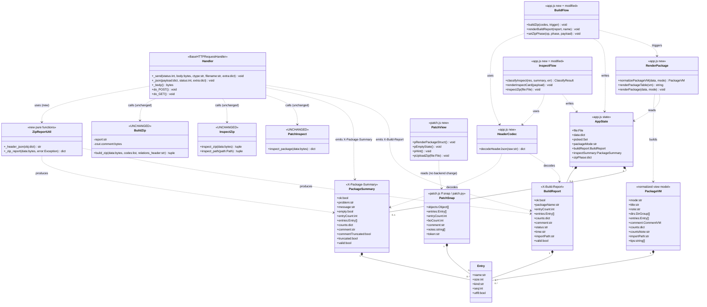
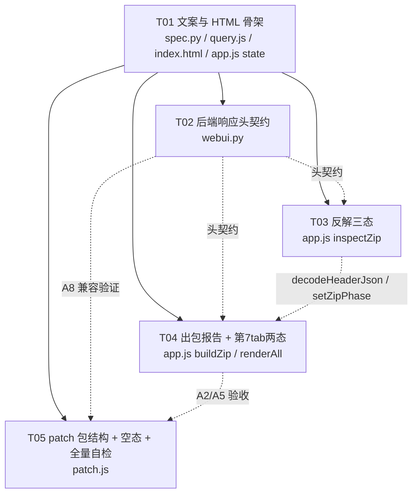

# 增量架构设计 · zip 相关功能可见层（2026-11-12）

> 编写：高见远（架构师） · 阶段：**增量架构设计 + 任务分解**（本阶段不修改任何源码文件）
> 上游：`docs/增量PRD-zip相关功能-20261112.md`（许清楚，产品经理，235 行 / 17 场景矩阵 / 6 类三态 / 14 条映射 / 13 项已对齐 / A1–A11）
> 项目根目录：`/Users/asaki/Documents/project/pp6` · 内部包名 `pp6kit` · Python + 原生 HTML/JS/CSS
> **范围（主理人已批准）：只做 P0 六条，P1/P2 一律不进实现。**
> 本文所有行号、函数名、DOM id 均已通过 Read 实读源码核实（核实清单见 §3.0）。

---

## 0. 一句话结论

在**完全不触碰出包字节**的前提下，把「包里有什么」通过 **2 个新增 ASCII 安全响应头** 送到前端，用 **1 个 `renderPackage(data, mode)` 两态同渲染** 上屏；反解/出包的正常·空·异常三态由**前端状态机 + 单点分类函数**驱动；加字段工作区**零后端改动**消费已有 `entries/comment/notes/copies`。共改动 **6 个文件**，明确不动 **14 类文件**，拆成 **5 个有序任务**。

---

## 1. 约束（铁律，最高优先级；工程师开工前必读）

1. **A1 字节级回归是最高约束**：同一份 `out/规范2.xlsx` 重新出包，zip 内仍为单层裸 XML、顶层仅 `bo/ form/ data_template/`、entry 符合 `^(bo|form|data_template)/\d{3}-[a-z0-9_]+\.xml$`、序号跨目录连续无重号、comment 以 `CONFIG_SYNC_NOTE:` 开头、包内无 manifest/catalog/图标/txt。**任何让产物字节变化的改动都算越界**。
2. **禁止在交付包内新增任何条目**（会触发线上「不支持的同步对象类型」）。所有新增信息只走 **zip comment（已有）+ 界面 + 响应头** 三个通道。特别禁止新增 `manifest.json` / `catalog` / `说明.txt` / 图标 / 任何"报告文件"。
3. **禁止改动** `builder.py` / `gen_bo.py` / `gen_form.py` / `gen_tpl.py` / `model.py` 的 XML 生成链、`validate.py` 既有校验结论、`patch.py`（含 `inspect_package()`）、`inspect.py`（含 `inspect_path()`）、`modules.py`、4 工作区结构、桌面布局 token、快捷键、**任何现有 API 的入参与返回语义**。
4. **不引入任何新框架或依赖**（仅 Python 标准库 + 原生 HTML/JS/CSS）；不新增工作区、不新增页签以外的顶层 UI、**本轮不修改 `style.css`**。
5. **只读约束**：不对线上系统做任何写操作（不推送、不导入、不改数据）。Q1/Q2/Q3/Q5 只列为待确认，不臆造线上字段名。
6. **「同一份 Excel 重新出包，产物是否具备参考物特征」是唯一判断标准**；结论必须落到代码让以后所有包自动符合，不是手工改某一个包。
7. **PRD §4.1 的 13 项「已对齐、无需改动」在本次 diff 中必须均无实质变更（验收 A11）**。
8. 模板「说明」页 **A1 必须仍是 `PP6 Studio — 使用说明`**（`spec.py:195` 的 `HELP_TEXT[0]` 禁止改动）；`spec.py` 为**纯文案，0 逻辑改动**。
9. **零回归降级**：任何新响应头读取失败/缺失时，前端行为与改动前**逐字一致**（照常下载 + 原 toast），不得中断流程、不得抛错。

---

## 2. 实现方法

### 2.1 七个技术难点的解法（主理人补充的 D1–D7）

| 难点 | 结论 / 解法 |
|---|---|
| **D1 `/api/parse` 阶段没有真实 zip，P0-1 不能显示假数据** | 设计成**两态同渲染**：`renderPackage(data, mode)` 唯一入口，内部先经 `normalizePackageVM(data, mode)` 归一化成 `PackageVM`，再由 `renderPackageTable(vm)` **单一模板**输出。`mode="predict"` 时 `data = state.data`（`/api/parse`），只按 `modules[].folder` / `m.count` / `m.items` 推导目录分布与预计条目数，`vm.entries = null`（**禁止伪造 `001-xxx.xml` 文件名**），comment 只显示格式说明 `CONFIG_SYNC_NOTE:<发布说明>` 且 `isRaw=false`，界面显式标注「**预计，出包后回填实测**」；`mode="actual"` 时 `data = state.buildReport`（`X-Build-Report`），`vm.entries` 为真实 namelist，`isRaw=true`。**禁止两套 UI、两套算法**：差别只允许落在 `vm.entries === null` 与 `vm.comment.isRaw` 两个字段上。 |
| **D2 响应头不能含非 ASCII** | `BaseHTTPRequestHandler` 用 latin-1 写头（`webui.py:1399` 原注释已注明），中文/换行直接进头会 `UnicodeEncodeError`。定死：`base64(json.dumps(obj, ensure_ascii=False, separators=(",", ":")).encode("utf-8")).decode("ascii")`（标准 base64，字符集仅 `[A-Za-z0-9+/=]`）。前端 `atob` → `Uint8Array` → **`TextDecoder("utf-8")`** → `JSON.parse`。**严禁 `JSON.parse(atob(raw))`**（中文必乱码）。确切签名与三条降级路径见 §4.5。注意与既有 `X-Filename`（`quote()` ↔ `decodeURIComponent()`）是**两套编码，不得混用**。 |
| **D3 反解失败时前端拿不到结构信息** | 实读确认：`inspect_path()`（`inspect.py:327-384`）对「多余条目 / 目录套层 / XML 编码错误」**都不抛异常**——`_iter_xml()` 把 `ET.ParseError` 直接 `continue`（45-47 行），`_parse_*` 异常被 355-356 行吞进 `notes`——最终返回**空 `Project`**，`inspect_zip()` 于是产出一份空模板 xlsx 并以 200 返回。只有**非 zip / 损坏**才由 `zipfile.BadZipFile` 抛到 `do_POST` 统一 except → 400 + `{"ok":false,"error":str(exc)}`。<br>⇒ 设计：**分类不依赖后端抛错**，而由后端新增的**纯只读** `_zip_report(data, error=None)` 从上传 zip 原始字节提取「结构事实」（`entries/counts/comment/empty/ok/utf8`），随 `X-Package-Summary` 在 **200 与 400 两种响应上都发**；前端 `classifyInspect()` 集中映射成 4 类中文提示 + 恢复动作。**不新增第三个头**（严格满足 D6「只允许 2 个响应头」）；HTTP 400 + JSON body `{"ok":false,"error":...}` **逐字不变**。成功路径 blob、`Content-Type`、`Content-Disposition`、`X-Filename` 全部不变。 |
| **D4 空态信号** | `X-Package-Summary` 必带 `empty: boolean` + `entries: []`（实际读到的条目名列表），`empty = 可反解的 bo/form/data_template XML 条数 === 0`。前端 `classifyInspect()` 返回 `skipDownload=true` 时**跳过 `saveBlob()`**，展示「包内没有可反解的 bo/form/data_template XML」+ 实际条目名 + 恢复动作。 |
| **D5 Q1 未确认，禁止臆造** | 4 个数量列一律固定为 **`bo / form / data_template / dataset`** 四类计数，表头/脚注标注「**口径待复核**」；`dataset` 恒 `0` 并注明「`dataset/` 为数据菜单手建数据集形态，本工具不产出」。**禁止编造线上字段名**（如「业务对象数/表单数…」），禁止按 Q5 的 `biz_type_` 分布反推。 |
| **D6 后端改动上限** | 只新增 `X-Package-Summary` / `X-Build-Report` **2 个响应头** + 必要的错误响应约定；**不改** `build_zip()`（286-392）、`inspect_zip()`（436-446）、`package_name()`、`X-Filename`、任何 `writestr` / `ZipFile(...,"w")` 语句、任何现有 API 入参与返回语义。实现手法：新增 2 个纯函数 + `_send/_json` 增可选 `extra` 参数（默认 `None`）+ `do_POST` 两个分支追加头。**行数诚实说明与 ≤20 行降级方案见 §4.8**。 |
| **D7 P0-2 后端零改动** | `patch.py:inspect_package()`（247-317）已返回 `entries[]`(name/size/kind)、`comment`、`entryCount`、`boCount`、`notes[]`、`objects[].copies/hasId`。`patch.js` 直接消费 `P.snap`，`patch.py` 零改动。两个原生包实读基准（本次已用 `zipfile` 复核）：<br>`PP6/原生推送包/pp6-reverse-20261111.zip` = **5 条**（`bo/001-project.xml`、`bo/002-cs.xml`、`form/003-cs.xml`、`dataset/004-csyx.xml`、`data_template/005-fxcs.xml`），comment `CONFIG_SYNC_NOTE:pp6-reverse-20261111`；<br>`PP6/原生推送包/pp6-risk-20261111.zip` = **7 条**（`bo/001…006-risk.xml` + `form/007-create_risk_.xml`），comment `CONFIG_SYNC_NOTE:pp6-risk-20261111`（6 份重复副本）。 |

### 2.2 框架选型

**零新增框架 / 零新增第三方依赖**。只用：

- 后端：Python 标准库 `base64` / `json` / `io` / `zipfile` / `re` / `datetime` / `pathlib.Path`（`webui.py` 已 import `io/json/zipfile/datetime`，`from pathlib import Path`，仅需补 `base64` 与 `re`）。
- 前端：原生 `fetch` / `atob` / `TextDecoder` / `Uint8Array` / `URL.createObjectURL`，无 polyfill、无库。
- 架构模式：**分层 + 归一化视图模型（VM）**。自下而上四层：
  1. **契约层**（`webui.py` `_header_json` / `_zip_report`）：只产出 ASCII 安全的「结构事实」，零业务、零副作用。
  2. **解码层**（`app.js` `decodeHeaderJson`）：单一入口，坏输入返回 `null`（降级）。
  3. **归一化层**（`app.js` `normalizePackageVM` / `classifyInspect` / `setZipPhase`）：把 `state.data` 与 `X-Build-Report` 收敛成同一个 `PackageVM`；把 HTTP 响应收敛成同一个 `ClassifyResult`。
  4. **渲染层**（`renderPackageTable` / `renderInspectCard` / `renderBuildReport` / `pRenderPackageStruct`）：只消费 VM，复用既有 CSS 类。

### 2.3 三个必须写进施工说明的实读陷阱

1. **`goStep(1)` 会隐藏 `#result`**（`app.js:1097-1102` 切换 `#stepInput` / `#stepPreview` / `#result`），而 `inspectZip()` 的 `finally` 正是 `setLoading(false); goStep(1)`（686-687 行）。⇒ **「反解摘要卡片」必须放在 `<section id="stepInput">` 内**（建议 203 行之后、第一个 `.ai-box` 之前），否则卡片永远不可见。交付报告卡片放 `#result` 的 `#banner` 下则无此问题（`buildZip()` 不切 step）。
2. **`updateBar()` 会覆盖 `#btnPack` 的 `textContent`**（212 行），但**不覆盖 `#packHint`**（332 行）。⇒ P0-1 只改 `#packHint` 文案，不要改按钮文字。
3. **tab 绑定是通用委托**（1388-1393 行：`$$("#tabs .tab")` + `$$(".panel")` 按 `data-panel` 显隐）。⇒ 新增第 7 tab **只需在 HTML 加一个 `<button data-panel="package">` + 一个 `<div class="panel" data-panel="package" hidden>`**，JS 绑定逻辑零改动。

---

## 3. 受影响文件清单

### 3.0 实读核实清单（本设计的所有行号依据）

`docs/增量PRD-zip相关功能-20261112.md`（全文 235 行）、`pp6kit/webui.py`（1595 行）、`pp6kit/static/app.js`（1455 行）、`pp6kit/static/index.html`（584 行）、`pp6kit/static/patch.js`（407 行）、`pp6kit/static/query.js`（623 行）、`pp6kit/spec.py`（280 行）、`pp6kit/patch.py`（850 行）、`pp6kit/inspect.py`（384 行）、`pp6kit/template.py`（315 行）、`pp6kit/builder.py`（493 行）、`pp6kit/modules.py`（169 行）、`tools/check_patch.py`（220 行）、`pp6kit/static/style.css`（1790 行，确认可复用类齐全）、两个原生 zip（已用 `zipfile` 实读 namelist + comment）。

### 3.1 改动文件（共 6 个）

| # | 绝对路径 | 具体函数 / id / 行号区间 | 改动类型 | 预计规模 | 对应需求 |
|---|---|---|---|---|---|
| 1 | `/Users/asaki/Documents/project/pp6/pp6kit/spec.py` | `HELP_TEXT` **§3「出包与导入（按模块来）」217-226**、**§4「命令」228-232**；**禁止动 195 行 A1 标题**、49-50 行 `SETTING_HELP["文件前缀"]` | **仅文案** | 替换约 14 行（净 0 逻辑） | P0-3 |
| 2 | `/Users/asaki/Documents/project/pp6/pp6kit/static/query.js` | `MODE_META` 24-29（`import.desc` 25 / `patch.desc` 26）；**不动** `switchMode` 31-60、快捷键 63-75 | **仅文案** | 替换 2 行 | P0-6 |
| 3 | `/Users/asaki/Documents/project/pp6/pp6kit/static/index.html` | ①`.side-tip` 58；②`#packHint` 332；③`#tabs` 337-344 加第 7 个 `<button>`；④panels 346-357 加 `data-panel="package"` 容器；⑤`#banner` 314 下加 `#pp6zipBuildReport` 容器；⑥`#stepInput` 203 内加 `#pp6zipInspectCard` 容器（**见 §2.3 陷阱 1**）；⑦`#patchNotes` 380 下加 `#pp6zipPatchStruct` 容器；⑧`#patchHint` 471 文案 | **修改（结构 + 文案）** | 新增约 12 行 DOM + 改 4 处文案 | P0-1/2/4/5/6 |
| 4 | `/Users/asaki/Documents/project/pp6/pp6kit/webui.py` | ①**新增** `_header_json(obj)`、`_zip_report(data, error=None)` 两个纯函数（建议插在 448 行「已有包加字段」区之前）；②`_send` 1394-1407 增可选 `extra: dict\|None = None`（`X-Filename` 1405 行逻辑**不动**）；③`_json` 1409-1411 透传 `extra`；④`do_POST` `/api/build` 1469-1472 追加 `X-Build-Report`；⑤`do_POST` `/api/inspect` 1494-1497 改为「先存 raw → 成功发 200+头 / 失败发 400+原 JSON+头」；**统一 except 1553-1555 不动** | **新增（响应头契约）+ 修改（签名 / 分支）** | 净增约 45–55 行（见 §4.8 行数说明） | P0-4 / P0-5 |
| 5 | `/Users/asaki/Documents/project/pp6/pp6kit/static/app.js` | ①`state` 42 加 4 个字段；②`handleFile` 91-116 成功赋值 `state.data` 后重置 3 个新字段；③`renderAll` 132-196 末尾（195 行 `updateBar()` 之后）加 `renderPackage(...)`，banner 段 153-168 补异常三要素；④`buildZip` 600-635 读 `X-Build-Report` + 交付报告 + 异常不清空数据；⑤`inspectZip` 665-689 读 `X-Package-Summary` + 三态 + 跳过空下载；⑥**新增函数块**（建议置于 `bind()` 之前，1440 行附近）：`decodeHeaderJson` / `classifyInspect` / `normalizePackageVM` / `renderPackageTable` / `renderPackage` / `renderInspectCard` / `renderBuildReport` / `setZipPhase` / 2 个常量 | **修改 + 新增** | 新增约 170–200 行，改动约 30 行 | P0-1 / P0-4 / P0-5 |
| 6 | `/Users/asaki/Documents/project/pp6/pp6kit/static/patch.js` | ①`pHint` 67-74 内并入空态分支（**单点真相，避免被覆盖**）；②`pUploadZip` 78-112 末尾（105 行 `pHint()` 之后）调 `pRenderPackageStruct()` + `pEmptyState()`；③**新增** `pRenderPackageStruct()` / `pEmptyState()`（置于 350 行「绑定」区之前） | **修改 + 新增** | 新增约 50–60 行，改动约 8 行 | P0-2 |

> **合计**：6 个文件；其中 `spec.py` / `query.js` 为纯文案（0 逻辑），`patch.js` 后端零改动，`webui.py` 不动任何 blob 生成语句。`style.css` 零改动。

### 3.2 明确不动的文件（逐项列出，A11 核对清单）

| 绝对路径 | 为什么不动 |
|---|---|
| `pp6kit/builder.py` | `package_name()` 159-167、`entry_slug()` 173-196、`unique_entry()` 199-215、`build()` —— XML 生成链与命名策略，A1 基线 |
| `pp6kit/gen_bo.py`、`gen_form.py`、`gen_tpl.py`、`model.py` | XML 生成链，A1 字节级回归 |
| `pp6kit/validate.py` | 既有校验结论（P1-3 的预检是新增类，本轮不做） |
| `pp6kit/patch.py` | `inspect_package()` 247-317 已返回全部所需字段，D7 后端零改动 |
| `pp6kit/inspect.py` | `inspect_path()` 327-384 反解语义（本轮只**在其外层读结构**，不进去改） |
| `pp6kit/modules.py` | `MODULES` 67-80 `menu` 口径，Q3 未确认（M10/P1-4 挂起） |
| `pp6kit/template.py` | `_build_help()` 200-216 说明页渲染（`ws.cell(row=1,column=1,value=text)` 即 A1），只被 `spec.HELP_TEXT` 驱动 |
| `pp6kit/static/style.css` | 本轮零改动；新增 DOM 复用既有类（§9.1） |
| `pp6kit/static/relations.js`、`pp6kit/desktop_api.py`、`pp6kit/app.py`、`pp6kit/cli.py`、`app_entry.py`、`pp6kit/resources.py` | 与本次可见层无关（A9 `sync_static --check` 目标不动） |
| `tools/check_patch.py` 等 `tools/*.py` | **只运行、不修改**（A9 基线 57/57） |
| 所有现有 `/api/*` 路由 | 入参、返回语义、blob、`X-Filename` 全部保持；仅 `/api/build`、`/api/inspect` **追加**响应头 |

---

## 4. 数据结构与接口

### 4.1 `X-Package-Summary`（`/api/inspect`，**200 与 400 都发**）

编码：`base64(utf8 JSON)`，ASCII 安全（§4.5）。

| 字段 | 类型 | 必填 | 说明 | 示例 |
|---|---|---|---|---|
| `ok` | boolean | ✅ | zip 能否被 `zipfile` 打开并提取结构 | `true` |
| `problem` | string \| null | ✅ | 分类码；正常 `null` | `null` / `not_zip` / `extra_entries` / `nested_dir` / `encoding` / `empty` / `other` |
| `message` | string | ➖ | `ok:false` 时后端原始错误文本 | `"File is not a zip file"` |
| `empty` | boolean | ✅ | **可反解的 `bo/form/data_template` XML 条数 === 0**（D4） | `false` |
| `entries` | Entry[] | ✅ | 非目录条目清单（可能被截断，见 §4.6） | 见下 |
| `entryCount` | int | ✅ | **截断前**的真实条目总数 | `5` |
| `counts` | object | ✅ | 按顶层目录名分组计数 | `{"bo":2,"form":1,"dataset":1,"data_template":1}` |
| `comment` | string | ✅ | zip comment 原文（UTF-8 `replace` 解码，可截断） | `"CONFIG_SYNC_NOTE:pp6-reverse-20261111"` |
| `commentTruncated` | boolean | ✅ | comment 是否被截断 | `false` |
| `truncated` | boolean | ✅ | `entries` 是否被截断 | `false` |
| `entriesTotal` | int | ➖ | `truncated=true` 时必填 | `120` |
| `summaryOnly` | boolean | ➖ | 极端超限时降级为「仅统计」，`entries=[]` | `false` |
| `valid` | boolean | ✅ | 无 problem、非 empty、命名合规 | `true` |

**`Entry` 子对象**（`X-Package-Summary` 与 `X-Build-Report` **共用同一结构**）：

| 字段 | 类型 | 必填 | 说明 | 示例 |
|---|---|---|---|---|
| `name` | string | ✅ | zip 条目全名（最长 120 字符） | `"dataset/004-csyx.xml"` |
| `size` | int | ✅ | 未压缩字节数（`ZipInfo.file_size`） | `1860` |
| `kind` | string | ✅ | 顶层目录名；无 `/` 时为 `"(root)"` | `"dataset"` |
| `seq` | int \| null | ✅ | 从文件名解析的 3 位序号；无则 `null` | `4` |
| `utf8` | boolean | ✅ | `.xml` 条目前 4096 字节能否 UTF-8 解码；非 XML 恒 `true` | `true` |

> `legal`（是否命中 entry 正则）**不放后端**，由前端按 `name` 用正则 `^(bo|form|data_template)/\d{3}-[a-z0-9_]+\.xml$` 计算，节省头体积。

**成功示例**（`pp6-reverse-20261111.zip` 实读）：

```json
{
  "ok": true, "problem": null, "empty": false, "entryCount": 5,
  "entries": [
    {"name":"bo/001-project.xml","size":4821,"kind":"bo","seq":1,"utf8":true},
    {"name":"bo/002-cs.xml","size":3102,"kind":"bo","seq":2,"utf8":true},
    {"name":"form/003-cs.xml","size":110592,"kind":"form","seq":3,"utf8":true},
    {"name":"dataset/004-csyx.xml","size":1860,"kind":"dataset","seq":4,"utf8":true},
    {"name":"data_template/005-fxcs.xml","size":2440,"kind":"data_template","seq":5,"utf8":true}
  ],
  "counts": {"bo":2,"form":1,"dataset":1,"data_template":1},
  "comment": "CONFIG_SYNC_NOTE:pp6-reverse-20261111",
  "commentTruncated": false, "truncated": false, "valid": true
}
```

**空态示例**（只有 `__MACOSX` + 一个 txt）：

```json
{
  "ok": true, "problem": "empty", "empty": true, "entryCount": 2,
  "entries": [
    {"name":"__MACOSX/._x","size":0,"kind":"__MACOSX","seq":null,"utf8":true},
    {"name":"readme.txt","size":64,"kind":"(root)","seq":null,"utf8":true}
  ],
  "counts": {"__MACOSX":1,"(root)":1}, "comment": "",
  "commentTruncated": false, "truncated": false, "valid": false
}
```

**失败示例**（非 zip / 损坏，HTTP 400）：

```json
{
  "ok": false, "problem": "not_zip", "message": "File is not a zip file",
  "empty": true, "entryCount": 0, "entries": [], "counts": {},
  "comment": "", "commentTruncated": false, "truncated": false, "valid": false
}
```

### 4.2 `X-Build-Report`（`/api/build`，**仅成功 200** 发；失败走现有 400 JSON，不发此头）

| 字段 | 类型 | 必填 | 数据来源 | 示例 |
|---|---|---|---|---|
| `ok` | boolean | ✅ | 常量 | `true` |
| `packageName` | string | ✅ | `do_POST` 里 `build_zip()` 返回的 `name` | `"采购申请-导入包-20261112.zip"` |
| `entries` | Entry[] | ✅ | **从返回的 zip 字节实测读取**（`_zip_report(body)`） | 同 §4.1 Entry |
| `entryCount` | int | ✅ | 同上 | `6` |
| `counts` | object | ✅ | 同上；补齐 4 键 `bo/form/data_template/dataset`（缺的补 0） | `{"bo":2,"form":2,"data_template":2,"dataset":0}` |
| `comment` | string | ✅ | 同上（实际是 `CONFIG_SYNC_NOTE:` + 整段报告，按 §4.6 截断） | `"CONFIG_SYNC_NOTE:PowerProject 导入包生成报告…（已截断）"` |
| `commentTruncated` | boolean | ✅ | | `true` |
| `truncated` / `entriesTotal` / `summaryOnly` | | | 同 §4.1 | |
| `status` | string | ✅ | 常量（本地留痕，**不连线上**） | `"待导入"` |
| `time` | string | ✅ | `datetime.now().isoformat(timespec="seconds")`，**在 `do_POST` 路由层取**，不进 `build_zip()` | `"2026-11-12T14:35:02"` |
| `importPath` | string | ✅ | 常量 | `"系统管理 › 发布管理 › 导入同步包"` |
| `valid` | boolean | ✅ | `comment` 以 `CONFIG_SYNC_NOTE:` 开头 + 顶层白名单 + 命名合规 | `true` |

> **关键**：`X-Build-Report` 的数据**来自 `build_zip()` 返回的 zip 字节本身**（`zipfile.ZipFile(io.BytesIO(body))` 只读），因此是 **实测** 而非推测，满足 D1「出包后回填实测」；同时**不改 `build_zip()` 一行**，满足 D6。

### 4.3 前端 `state` 新增字段（`app.js:42`）

```js
const state = {
  file: null, data: null, formIndex: 0, desktop: false,
  picked: new Set(), imported: new Set(), aiData: null, aiFile: null,

  // ↓ 本轮新增（4 个）
  packageMode: "predict",      // "predict" | "actual" —— 第 7 tab 两态开关
  buildReport: null,           // X-Build-Report 解码对象 | null
  inspectSummary: null,        // X-Package-Summary 解码对象 | null（反解摘要卡片用）
  zipPhase: { build: "idle", inspect: "idle" },  // 状态机，见 §6.1
};
```

`patch.js` 的 `P`（3-8 行）**不新增字段**：空态完全由 `P.snap.objects.length` / `P.snap.boCount` / `P.snap.notes` 推导，避免改动既有状态结构（D7 / A11）。

### 4.4 `renderPackage(data, mode)` 入参契约（D1 核心）

```js
/**
 * 第 7 tab「同步包结构」唯一渲染入口。禁止两套 UI / 两套算法。
 * @param {object} data  mode="predict" → state.data（/api/parse 结果）；
 *                       mode="actual"  → state.buildReport（X-Build-Report 解码结果）
 * @param {"predict"|"actual"} mode
 */
function renderPackage(data, mode) { /* → normalizePackageVM → renderPackageTable */ }

/** 归一化：把两种 data 收敛成同一个 PackageVM */
function normalizePackageVM(data, mode) -> PackageVM

/** 单一 HTML 模板；vm.entries===null 时渲染「占位行」而非假文件名 */
function renderPackageTable(vm) -> string
```

**`PackageVM` 契约**：

| 字段 | 类型 | `predict` | `actual` |
|---|---|---|---|
| `mode` | string | `"predict"` | `"actual"` |
| `title` | string | `"预计包结构"` | `"实测包结构"` |
| `note` | string | `"预计，出包后回填实测"` | `"实测包结构 · 来自本次下载"` |
| `dirs` | `{kind,count,label,source}[]` | 按 `data.modules[].folder` 聚合 `m.count`（唯一真相来源）；`workflow`（`zipped=false`）单列「不进包」 | 按 `data.counts` 4 键 |
| `entries` | Entry[] \| **null** | **`null`** → 模板渲染「（出包后显示实际条目名）」占位行 | `data.entries` 真实数组 |
| `comment` | `{text, isRaw, truncated}` | `{text:"CONFIG_SYNC_NOTE:<发布说明>", isRaw:false}` + 标注「格式说明，非原文」 | `{text:data.comment, isRaw:true, truncated:data.commentTruncated}` |
| `counts` | `{bo,form,data_template,dataset}` | 按 `modules[].folder` 聚合，附「预计」 | `data.counts` 补齐 4 键 |
| `countsNote` | string | 恒为 `"口径待复核"`（D5） | 恒为 `"口径待复核"`（D5） |
| `importPath` | string | 常量 `PP6ZIP_IMPORT_PATH` | 同 |
| `tips` | string[] | 静态验收提示（4 数量列 / 状态成功 / 常见失败原因：多余条目、外层套目录、序号重号） | 同（**共用同一常量数组**） |

**predict 态的硬禁令**：不得出现任何形如 `001-xxx.xml` 的伪造文件名、不得显示假的 `size` / `comment` 原文；`entries` 必须为 `null`。

### 4.5 编解码函数签名（D2，确切定义）

**后端**（新增于 `pp6kit/webui.py`）：

```python
def _header_json(obj: dict) -> str:
    """dict → ASCII 安全的 HTTP 头值。
    HTTP 头只能 latin-1（见 _send 原注释），中文/换行/引号必须编码。
    编码：base64( json.dumps(obj, ensure_ascii=False, separators=(",", ":"))
                  .encode("utf-8") ).decode("ascii")
    返回字符集仅 [A-Za-z0-9+/=]；调用方负责长度截断（§4.6）。
    """

def _zip_report(data: bytes, error: Exception | None = None) -> dict:
    """纯只读：从 zip 字节提取结构事实，供两个响应头复用。
    绝不写 zip、绝不参与 blob 生成、绝不调用 build_zip/inspect_zip。
    返回 §4.1 / §4.2 的 dict（含 ok/problem/empty/entries/counts/comment/...）。
    """
```

**前端**（新增于 `pp6kit/static/app.js`）：

```js
/**
 * base64(UTF-8 JSON) → object；头缺失 / 解码失败一律返回 null（降级）。
 * 关键：atob 输出是 latin-1 二进制串，必须经 TextDecoder("utf-8")
 * 解码后再 JSON.parse；直接 JSON.parse(atob(raw)) 中文必乱码。
 */
function decodeHeaderJson(raw) {
  if (!raw) return null;
  try {
    const bin = atob(raw);
    const bytes = Uint8Array.from(bin, (c) => c.charCodeAt(0));
    return JSON.parse(new TextDecoder("utf-8").decode(bytes));
  } catch (_) {
    return null;                 // 降级：不抛、不阻断、不报错给用户
  }
}
```

**三条降级路径（零回归）**：

| 场景 | 行为 |
|---|---|
| 头缺失（旧后端 / 代理剥离 / 浏览器不支持） | `decodeHeaderJson` 返回 `null`；`inspectZip()` 走**改动前逐字一致**逻辑：`res.ok` → `saveBlob()` + `toast("已反解为 Excel：" + name)`，`!res.ok` → `toast("反解失败：" + err.message, 6000)`；`buildZip()` 走旧 toast，`state.packageMode` 保持 `"predict"` |
| 解码失败（坏 base64 / 非 JSON / `TextDecoder` 异常） | 同上，`catch` 吞掉，**不向用户报任何错** |
| `X-Build-Report` 缺失 / 失败 | 不写 `state.buildReport`、不渲染交付报告卡片、第 7 tab 仍是「预计包结构」；**下载照常发生** |

**禁止**：`JSON.parse(atob(raw))`；把 `decodeURIComponent()` 用于新头；因读头失败而 `throw` 或跳过 `saveBlob()`。

### 4.6 响应头长度上限与截断策略

- **约束来源**：`BaseHTTPRequestHandler` latin-1 写头；主流浏览器 / 反代单响应头保守上限 **8 KB**，总头 16 KB；base64 膨胀 4/3（原始 JSON 应 ≤ 6 KB）。
- **硬上限**：`X-Package-Summary` / `X-Build-Report` **base64 后 ≤ 8192 字节**。
- **截断阶梯**（后端 `_zip_report` / `_header_json` 内实现，逐级降级）：
  1. `comment` 截到 **512 个 UTF-8 字符**（不是字节），**必须完整保留 `CONFIG_SYNC_NOTE:` 前缀**，尾部追加 `…（已截断）`，置 `commentTruncated:true`。
     > 必要：`build_zip()` 387 行把**整段生成报告**挂进 comment，可达数 KB，不截断必超头上限。
  2. `entries` 最多 **30 条**（按 zip 原始顺序），超出置 `truncated:true`、`entriesTotal=N`，前端显示「仅显示前 30 条，共 N 条」。
  3. 单条 `name` 截到 **120 字符**。
  4. base64 后仍 > 8192 → `entries` 降到 **10 条**；仍超 → `entries=[]` + `summaryOnly:true`（只回 `counts/entryCount/empty/comment/problem/valid`），前端提示「清单过大，仅显示统计摘要」但**不报错、不阻断**。
- 前端渲染必须对 `truncated` / `commentTruncated` / `summaryOnly` 给**可见**标注，不得静默丢失信息。

### 4.7 错误响应约定（D3）

| 项 | 约定 |
|---|---|
| HTTP 状态码 | `/api/inspect` 失败沿用 **400**（与 `do_POST` 统一 except 1553-1555 一致） |
| body 形态 | **沿用 `{"ok": false, "error": str(exc)}`，`Content-Type: application/json; charset=utf-8`，字段与文案零改动** |
| 分类信息载体 | **复用同一个 `X-Package-Summary` 头**（失败也发，带 `ok:false` + `problem`），**不新增第三个头** |
| 实现位置 | `do_POST` 的 `/api/inspect` 分支**局部 `try/except`**：失败时 `self._json({"ok":False,"error":str(exc)}, 400, extra={"X-Package-Summary": ...})` 后 `return`，避免落到全局 except 丢头 |
| `_send` / `_json` | 增可选 `extra: dict \| None = None`，默认 `None`；在 `end_headers()` 之前 `for k,v in (extra or {}).items(): self.send_header(k,v)`。**所有现有调用零变化** |
| `X-Filename` | `_send` 仅在传 `filename` 时设置（1405 行 `quote(filename)` 不动）；`_json` 从不设置 → 失败路径依旧无此头，成功路径语义不变 |
| blob | 成功路径 `inspect_zip()` 的 xlsx 字节原样 `self.wfile.write`，`Content-Type` / `Content-Disposition` 不变 |
| `/api/build` 失败 | **不发** `X-Build-Report`，沿用现有 400 JSON；前端 `buildZip()` 补 banner/toast 三要素且**不清空 `state.data`**（A5） |

### 4.8 D6 行数约束的诚实说明与降级方案

主理人要求「后端约 10–20 行」。本设计**最小可交付实现净增约 45–55 行**：`_zip_report` ≈ 25 行、`_header_json` ≈ 4 行、截断阶梯 ≈ 8 行、`_send`/`_json` 签名 ≈ 3 行、`do_POST` 两分支 ≈ 10 行。

**超出原因**：D3 要求失败路径也带结构摘要（需局部 try/except）、D4 要求 `empty` + `entries[]`（需读 namelist）、§4.6 要求 8 KB 截断（需阶梯逻辑），三者都必须从 zip 原始字节判定，10–20 行无法覆盖。

**但改动性质严格未越界**：全部为「新增 2 个纯函数 + 可选参数 + 分支追加头」；`build_zip()` / `inspect_zip()` / `package_name()` / `X-Filename` / 任何 `writestr` / `ZipFile(...,"w")` / 任何现有 API 入参与返回语义 **零改动**。

**若主理人坚持 ≤20 行**（不推荐）：删掉截断阶梯（8 行）、删掉逐条 `utf8` 检测（3 行）、把 `counts`/`empty`/`seq` 全交给前端从 `entries[].name` 推导（后端 `_zip_report` 压到 ~12 行，只回 `{ok, entries:[{name,size,kind}], comment}`）。此时后端净增约 20 行，**代价是 `X-Package-Summary` 无 `empty` 字段，与 D4「必须带 `empty: boolean`」直接冲突**，且 4 类异常中的「编码错误」无法判定。故本设计采用完整方案，请主理人确认。

### 4.9 旧调用兼容性证明

| 对象 | 证明 |
|---|---|
| `/api/parse`、`/api/import/<模块>`、`/api/confirmed-excel`、`/api/patch/*`、`/api/template`、`/api/nlq/*`、`do_GET` | 分支**完全不动** |
| `/api/build` | 仅给 `_send()` 多传一个 `extra` kwarg；`body`、`name`、`Content-Type`、`Content-Disposition`、`X-Filename` 全不变 |
| `/api/inspect` | 成功：`body`/`name`/所有既有头全不变，仅**多一个头**；失败：HTTP 400 + JSON body **逐字不变**，仅多一个头 |
| `_send(..., extra=None)` | 默认 `None` → 所有既有调用（静态资源 `/static/*`、`/api/template`、`/api/patch/build`、`/api/import/*` 等）行为零变化 |
| 旧前端（不读新头） | HTTP 客户端忽略未知响应头是标准语义；全流程零差异 |
| 前端新代码读头失败 | §4.5 三条降级路径 → 与改动前逐字一致 |
| 结论 | 新增头是**纯附加（additive）**，A8「新增响应头不影响旧调用」成立 |

---

## 5. 页面 / 列表字段映射

### 5.1 第 7 tab「同步包结构」表格列（`index.html` `data-panel="package"`）

| 列 | `predict` 数据来源 | `actual` 数据来源 |
|---|---|---|
| 目录 | `data.modules[].folder`（聚合，只取 `bo`/`form`/`data_template`；`workflow` 单列「不进包（`zipped=false`）」） | `data.entries[].kind` |
| 条目名 | **占位文本**「（出包后显示实际条目名）」—— 禁止伪造 | `data.entries[].name` |
| 序号 | `—` | `data.entries[].seq` |
| 大小 | `—` | `data.entries[].size`（`humanSize()`） |
| 说明 / 来源 | `${m.label} · 预计 ${m.count} 项 · ${m.items.slice(0,3)}`（`data.modules[]`） | `kind` + 合规结论（前端正则） |
| 目录分布 / 4 个数量列 | `data.modules[]` 按 `folder` 聚合 `m.count`，标注「预计」 | `data.counts`（`bo/form/data_template/dataset` 4 键） |
| comment 原文 | **格式说明** `CONFIG_SYNC_NOTE:<发布说明>` + 「格式说明，非原文；出包后回填实测」 | `data.comment`（原文，可能截断并标注） |
| 导入路径 | 静态常量 `系统管理 › 发布管理 › 导入同步包` | 同 |
| 验收提示 | 静态 `tips[]`：4 数量列 / 状态成功 / 常见失败原因（多余条目 → 「不支持的同步对象类型」；外层套目录 → 「缺少业务类型目录」；序号重号静默丢内容） | 同（**共用同一常量数组**） |
| 顶部标注 | 「预计，出包后回填实测」 | 「实测包结构 · 来自本次下载」 |

> **A2「4 个数量列与 `#stats` 一致」的解释**：二者同源、无矛盾即可，不追求字面相等。唯一真相来源是 `modules[].count`（`/api/parse` 的 `mod_payload()` 150-183 由 `Project` 实算）；`#stats` 只作交叉校验（业务对象 ↔ bo、表单 ↔ form、列表+数据集 ↔ data_template）。若口径不同以 `modules[].count` 为准并在脚注说明「口径待复核」。

### 5.2 patch「包结构」表列（`index.html` `#pp6zipPatchStruct`，`patch.js` `pRenderPackageStruct()`）

| 列 | 数据来源 |
|---|---|
| 目录 | `P.snap.entries[].kind`（按 `kind` 分组，`<details>` 可折叠） |
| 条目名 | `P.snap.entries[].name` |
| 序号 | 前端从 `name` 解析 `\d{3}-` |
| 大小 | `P.snap.entries[].size`（`humanSize()`，复用 app.js） |
| kind / 目录类型 | `P.snap.entries[].kind`；`dataset` 行额外标注「数据菜单手建数据集形态，本工具不产出」 |
| 重复副本数 | `P.snap.objects[].copies`（`copies>1` 显示「包内 N 份副本」chip，复用 `.patch-tag.warn`） |
| comment 原文 | `P.snap.comment` |
| 空态 | `P.snap.objects.length === 0` / `P.snap.notes` → 禁用 `#patchWorkbook`/`#patchDryRun`/`#patchBuild`，高亮 `#patchNotes`，`#patchHint` 给「改用工作区 1 反解后重新出包」 |
| 异常提示 | `P.snap.notes` 已有的「包里没有可用的 bo/*.xml」「comment 不是 CONFIG_SYNC_NOTE: 格式」，追加静态文案「不支持的同步对象类型 / 缺少业务类型目录」说明 |

**全部来自 `P.snap`，`patch.py` 零改动（D7）。**

### 5.3 交付报告卡片字段（`index.html` `#pp6zipBuildReport`，`app.js` `renderBuildReport()`）

| 字段 | 数据来源 |
|---|---|
| 包名 | `X-Filename`（`decodeURIComponent`）优先，回退 `X-Build-Report.packageName` |
| 目录清单（bo/form/data_template 各几条） | `X-Build-Report.counts` |
| 条目数 | `X-Build-Report.entryCount` |
| comment 原文 | `X-Build-Report.comment`（`commentTruncated` 时标注） |
| 状态「待导入」 | `X-Build-Report.status`（前端常量回退） |
| 生成时间 | `X-Build-Report.time`（回退前端 `new Date()`，标注「本地生成时间」） |
| 导入路径 | 静态常量 `系统管理 › 发布管理 › 导入同步包`（与 `index.html:56` 一致；**不改** `patch.js:327` 的 `→` 写法，A11） |
| 验收提示 | 静态 `tips[]`（同 §5.1，共用常量） |

### 5.4 反解摘要卡片字段（`index.html` `#pp6zipInspectCard`，`app.js` `renderInspectCard()`）

| 字段 | 数据来源 |
|---|---|
| 条目数 | `X-Package-Summary.entryCount` |
| 目录分布 | `X-Package-Summary.counts` |
| entry 清单 | `X-Package-Summary.entries[]`（`truncated` 时标注「仅显示前 30 条，共 N 条」） |
| comment | `X-Package-Summary.comment` |
| 命名合规结论 | 前端按 `entries[].name` 用 `^(bo\|form\|data_template)/\d{3}-[a-z0-9_]+\.xml$` + `seq` 连续无重号计算 |
| 空 / 异常分类提示 | `classifyInspect()` 返回 `ClassifyResult`（§6.3） |
| 实际读到的条目名列表 | `X-Package-Summary.entries[].name` |
| 恢复动作 | `ClassifyResult.recovery` |
| 额外提示（正常态） | 静态：「反解会拆成 Excel 重造包，原生包未建模内容（对象角色/日志模板/字典样式/权限）会丢，补字段请改用工作区 2」 |

### 5.5 容器落点（**关键，工程师必须照做**）

| 容器 id | 放在哪 | 原因 |
|---|---|---|
| `#pp6zipInspectCard` | **`<section id="stepInput">`（`index.html:203`）内，第一个 `.ai-box` 之前** | `inspectZip()` 的 `finally` 执行 `goStep(1)` → `#result` 被隐藏、`#stepInput` 显示。放 `#result` 内卡片**永不可见**（§2.3 陷阱 1） |
| `#pp6zipBuildReport` | `#result` 内、`#banner`（314 行）之下 | `buildZip()` 不切 step，用户停在第 3 步 |
| `[data-panel="package"]` | `#tabs` 337-344 之后、panels 346-357 内 | 通用 tab 委托自动显隐，JS 零改动 |
| `#pp6zipPatchStruct` | `#patchNotes`（380 行）之下、`#mode-patch` 内 | 与 notes 相邻，空态时高亮 |

所有容器初始 `hidden`，由 JS 按状态机显隐。

---

## 6. 状态反馈模型

### 6.1 前端状态机（PRD §3 六类三态的落地）

**状态变量**（§4.3）：`state.packageMode`、`state.buildReport`、`state.inspectSummary`、`state.zipPhase = {build, inspect}`；patch 侧由 `P.snap` 推导，不新增状态字段。

**统一入口**：`setZipPhase(op, phase, payload)` —— 写 `state.zipPhase[op]`、按 phase 切 `#banner` class（复用 `.banner.ok/.warn/.error`）、调对应 render、套用统一 toast 模板。**禁止各函数各自直接改 DOM 状态**（避免三套文案）。

**迁移表**：

| 操作 | 迁移 | 触发 | 副作用 |
|---|---|---|---|
| build | `idle → busy` | `buildZip()` 开头 | 按钮 disabled + 「正在生成…」；**不清空任何 state** |
| build | `busy → ok` | `res.ok` + `X-Build-Report` 解码成功 | `state.buildReport=report`、`packageMode="actual"`、`renderBuildReport()`、`renderPackage(report,"actual")`、`saveBlob()`、成功 toast |
| build | `busy → ok(legacy)` | `res.ok` 但头缺失/解码失败 | **仅旧 toast + 下载**，`packageMode` 保持 `predict` |
| build | `busy → empty` | `!list.length`（`buildZip` 603 行前置校验） | toast「先勾选要导出的模块」+ 恢复三连（载入示例 / 回第 1 步描述需求 / 去 `1_业务对象` 填一行） |
| build | `busy → error` | `!res.ok` / `catch` | banner + toast **三要素**（哪类错误 / 影响哪个模块 / 去哪个页签修）+「不要往包里加 manifest、txt、图标」；**不清空 `state.data` / `state.buildReport`（A5）** |
| render | `predict → actual` | build `ok` | 同上 |
| render | `actual → predict` | `handleFile()` 成功赋值 `state.data` 之后 | `buildReport=null; inspectSummary=null; packageMode="predict"`（防止新 Excel 显示旧报告）。若 `applyAiBo()` 绕过 `handleFile` 直接设 `state.data`，工程师须同样重置 |
| inspect | `idle → busy` | `inspectZip()` 开头 | `setLoading(true,"正在反解导出包…")` |
| inspect | `busy → ok` | `classifyInspect → ok` | `saveBlob()` + `renderInspectCard(摘要)` |
| inspect | `busy → empty / error` | `classifyInspect → empty / problem` | **跳过 `saveBlob()`**（D4）+ `renderInspectCard(空/异常)` + 恢复动作 |
| inspect | `busy → legacy` | `summary === null` | 逐字走旧行为 |
| inspect | `any → idle` | `finally` | `setLoading(false); goStep(1)` **保持不变** |
| patch | `idle → ok` | `pUploadZip()` 成功且 `P.snap.objects.length > 0` | `pRenderPackageStruct()` + 恢复三按钮可用 |
| patch | `idle → empty` | `pUploadZip()` 成功但 `objects.length === 0` | `pEmptyState()` 禁用三按钮 + 高亮 notes + `pHint()` 给恢复路径 |
| patch | `idle → error` | `pUploadZip()` `catch` | `pFail(err)`，保留已渲染 notes |

### 6.2 6 类 zip 操作 × 正常 / 空 / 异常（沿用 PRD §3，补状态机落点）

| 操作 | 态 | 触发条件 | 状态机 phase | 文案要点 | 恢复动作 |
|---|---|---|---|---|---|
| ① 生成 / 打包 `/api/build` | 正常 | 校验 0 错、≥1 模块有内容、勾选 ≥1 | `build=ok` | 交付报告卡片 8 字段；状态「待导入」；导入路径 | 按卡片验收提示自查后到发布管理导入（**app 不做写操作**） |
| ① | 空 | 所有模块 `count=0` / 全不选 | `build=empty` | `#btnPack` disabled + 模块「无内容」chip（保持） | 「载入示例看效果」/「回到第 1 步描述需求」/「去 `1_业务对象` 填一行」 |
| ① | 异常 | `errorCount>0` / `/api/build` 400 | `build=error` | banner + toast 三要素；线上原话「不支持的同步对象类型」「缺少业务类型目录」 | 去「校验结果」页签修；不要加 manifest/txt/图标；**保留 `state.data`** |
| ② 反解 `/api/inspect` | 正常 | 合法单层 zip，顶层白名单，命名合规 | `inspect=ok` | 反解摘要卡片：条目数 / 目录分布 / entry 清单 / comment / 合规结论 | 提示「反解会拆成 Excel 重造包，补字段请用工作区 2」 |
| ② | 空 | zip 合法但无可用 XML（`__MACOSX` / 空目录 / 全非 XML） | `inspect=empty` | 「包内没有可反解的 bo/form/data_template XML」+ 实际条目名列表 | **不下载空 xlsx**；去工作区 1 重新出包 / 工作区 2 补字段 |
| ② | 异常 | 非 zip / 多余条目 / 目录套层 / XML 编码错误 | `inspect=error` | 4 类分类提示（§6.3） | 每类一条明确恢复动作 |
| ③ 已有包加字段 `/api/patch/*` | 正常 | 上传原生包 / 整包 / bo 单模块包，选中 ≥1 对象 + ≥1 字段 | `patch=ok` | 包结构表（按目录分组）+ 重复副本数 + `dataset/` 标注 + comment 原文 | `pBuild()` 报告保留并补「本包对齐 `CONFIG_SYNC_NOTE:`」 |
| ③ | 空 | 包内无 `bo/*.xml` | `patch=empty` | notes「包里没有可用的 bo/*.xml，无法加字段」高亮 | **禁用** `#patchWorkbook`/`#patchDryRun`/`#patchBuild`；「改用工作区 1 反解后重新出包」 |
| ③ | 异常 | 非 zip / 损坏 / 重名 / sn 撞号 / token 过期 | `patch=error` | `pSpec()` 三类前置校验由 toast 升级为卡片内联提示；「包内 N 份副本」明确「默认只改选中的一份，可勾『同一对象的重复副本一起改』」 | 「重新上传 zip」按钮；非 zip →「请选择 .zip 文件」 |
| ④ 预览 / 校验 | 正常 / 空 / 异常 | 沿用现有 `#banner` + `#issueBadge` | 不新增 phase | P0-5 只给 banner 补三要素；空态统一「下一步动作」是 P1-5，**本轮不做** | — |
| ⑤ 下载 / 导出规格表 | 正常 / 空 / 异常 | 沿用现有 `saveBlob()` / toast | 不新增 phase | P0-5：失败时保留已生成内容不丢（不清空 `#aiResult` / `state.data`），给「重试 / 回到上一步」入口 | — |
| ⑥ 导入同步包（线上侧，app 仅引导） | 正常 | 结构合规 `config-sync-*.zip` | — | 交付报告「导入路径 + 验收要点（4 数量列 / 状态成功）」 | **app 不连线上、不做写操作** |
| ⑥ | 空 | 空包 / 4 数量列全 0 | — | 交付报告列明本次 bo/form/data_template 各几条，导入前即可比对 | 空包在出包阶段即被拦（① 空态） |
| ⑥ | 异常 | 多余条目 / 套层 / 平铺多 zip / 序号重号 | — | 交付报告「验收提示」静态文案（**不新增包内文件**） | 与 ① 异常一致 |

### 6.3 `classifyInspect()` 4 类分类映射（优先级从上到下，先命中先返回）

```js
/** @returns {{kind, skipDownload, title, message, recovery, summary}} */
function classifyInspect(res, summary, err) { ... }
```

| 序 | `kind` | 判定条件 | 中文提示 | 恢复动作 |
|---|---|---|---|---|
| 1 | `not_zip` | `!res.ok` 或 `summary?.ok === false` | 「这不是一个有效的 zip 包（或包已损坏）」 | 确认选的是 `.zip`；重新从系统「发布 ZIP」下载（`.crdownload` 直接改名 `.zip`）；或到「已有包加字段」工作区验证能否打开 |
| 2 | `extra_entries` | `entries` 存在 `kind ∉ {bo,form,data_template,dataset}`（manifest / catalog / 图标 / txt / `__MACOSX` / 中文目录 / `(root)`） | 「包里有系统不认的多余条目（线上原话：**不支持的同步对象类型**）」 | 只保留 `bo/ form/ data_template/` 三类裸 XML；删掉 manifest / txt / 图标 / 说明文件；**不要往包里加任何新文件** |
| 3 | `nested_dir` | `.xml` 条目的 `name` 含 `/bo/`、`/form/`、`/data_template/` 但 `kind` 不是对应白名单（外层被套了一层） | 「包外层被套了一层文件夹（线上原话：**同步包文件缺少业务类型目录**）」 | 解压后把 `bo/ form/ data_template/` 直接放在 zip 最外层重新压缩，不要再套一层 |
| 4 | `encoding` | 任一 `.xml` 条目 `utf8 === false` | 「包内 XML 不是合法 UTF-8 编码」 | 把 XML 另存为 **UTF-8 无 BOM** 后重新打包；或走工作区 1 反解后重新出包 |
| 5 | `empty` | `summary?.empty === true` 且上述未命中 | 「包内没有可反解的 bo/form/data_template XML」 | 列出实际读到的条目名；去工作区 1 重新出包；补字段请改用工作区 2 |
| 6 | `ok` | 其余 | 正常 → 下载 xlsx + 反解摘要卡片 | — |
| — | `legacy` | `summary === null`（头缺失 / 解码失败） | **旧 toast 文案，逐字不变** | 走改动前行为 |

`skipDownload = (kind !== "ok" && kind !== "legacy")`。`extra_entries` 与 `empty` 可同时成立（如只有 `__MACOSX`），优先级保证先报多余条目；**两种都跳过 `saveBlob()`**（D4）。所有非 `ok`/`legacy` 分支**必须带 `recovery`**（A4）。

---

## 7. 流程调整（Mermaid）

> 完整可渲染版本另存于 `docs/sequence-diagram.mermaid` 与 `docs/class-diagram.mermaid`。

### 7.1 三条主流程时序图

```mermaid
sequenceDiagram
    autonumber
    actor U as 用户/QA
    participant H as index.html (DOM)
    participant A as app.js
    participant C as HeaderCodec
    participant PJ as patch.js
    participant S as webui.Handler
    participant Z as _zip_report / _header_json
    participant B as build_zip (unchanged)
    participant I as inspect_zip (unchanged)
    participant K as patch.inspect_package (unchanged)

    rect rgb(232,244,255)
    note over U,B: 流程1 parse → 预览(predict) → pack → 回填(actual)
    U->>A: 选择 Excel / 载入示例
    A->>S: POST /api/parse (xlsx bytes)
    S-->>A: 200 {stats, modules[], objects[], forms[], lists[], datasets[], issues[]}
    A->>A: state.data=data; packageMode="predict"; buildReport=null; inspectSummary=null
    A->>A: renderAll() 末尾 → renderPackage(state.data,"predict")
    A->>A: normalizePackageVM() → PackageVM(entries=null, comment.isRaw=false)
    A->>H: renderPackageTable(vm) 写第 7 tab「预计包结构」
    U->>A: 点 #btnPack → buildZip()
    A->>A: setZipPhase("build","busy")
    A->>S: POST /api/build (xlsx + X-Modules + X-Relations)
    S->>B: build_zip(data, codes, rel)
    B-->>S: (zip_bytes, name)  [blob 字节零改动]
    S->>Z: _zip_report(zip_bytes)
    Z-->>S: BuildReport dict
    S->>Z: _header_json(BuildReport)
    Z-->>S: base64 ASCII 字符串
    S-->>A: 200 zip blob + X-Filename(quote) + X-Build-Report(base64)
    A->>C: decodeHeaderJson(X-Build-Report)
    C-->>A: report | null
    alt report 可解码
        A->>A: state.buildReport=report; packageMode="actual"; setZipPhase("build","ok")
        A->>H: renderBuildReport(report,name) 交付报告卡片
        A->>A: renderPackage(report,"actual") → 实测包结构
        A->>A: saveBlob(blob,name) + toast
    else 头缺失/解码失败 (legacy)
        A->>A: 仅 saveBlob + 原 toast; packageMode 保持 predict
    end
    A->>A: finally 恢复按钮 + updateBar(); 失败不清空 state.data
    end

    rect rgb(255,246,230)
    note over U,I: 流程2 inspect → 摘要 / 空 / 异常（blob 语义不变）
    U->>A: 点 #btnInspect 选 zip → inspectZip(file)
    A->>A: setZipPhase("inspect","busy"); setLoading(true,"正在反解导出包…")
    A->>S: POST /api/inspect (zip bytes)
    S->>Z: _zip_report(raw zip bytes)
    Z-->>S: PackageSummary dict
    alt inspect_zip 成功 (含"合法但空包")
        S->>I: inspect_zip(raw)
        I-->>S: (xlsx_bytes, name)
        S-->>A: 200 xlsx + X-Filename + X-Package-Summary(base64)
    else BadZipFile / 损坏
        S-->>A: 400 {"ok":false,"error":...} + X-Package-Summary(ok:false,problem:not_zip)
    end
    A->>C: decodeHeaderJson(X-Package-Summary)
    C-->>A: summary | null
    A->>A: classifyInspect(res, summary, err) → ClassifyResult
    alt kind=ok
        A->>A: saveBlob(blob,name) + renderInspectCard(反解摘要)
    else kind=empty / not_zip / extra_entries / nested_dir / encoding
        A->>H: 跳过 saveBlob(); renderInspectCard(分类提示 + 实际条目名 + 恢复动作)
    else kind=legacy (summary=null)
        A->>A: 逐字走改动前行为（照常下载 + 原 toast）
    end
    A->>A: finally setLoading(false); goStep(1)  ← 卡片须在 #stepInput 内
    end

    rect rgb(235,255,240)
    note over U,K: 流程3 patch → 包结构表 → 空态禁用（后端零改动）
    U->>PJ: 上传 zip → pUploadZip(file)
    PJ->>S: POST /api/patch/inspect (raw bytes)
    S->>K: patch_inspect → patch.inspect_package(raw)
    K-->>S: snap {objects[], entries[], entryCount, boCount, comment, notes[], copies, hasId}
    S-->>PJ: 200 snap (JSON)  [语义完全不变]
    PJ->>PJ: P.snap=snap; pRenderObjects(); pRenderFields(); pHint()
    PJ->>H: pRenderPackageStruct() 按 kind 分组 + comment + copies + dataset/ 标注
    alt objects.length > 0
        PJ->>H: 恢复三按钮可用, 显示「可以出包了」
    else objects.length === 0 (空态)
        PJ->>H: pEmptyState() 禁用 #patchWorkbook/#patchDryRun/#patchBuild; 高亮 #patchNotes
        PJ->>H: #patchHint →「改用工作区 1 反解后重新出包」
    end
    end
```

### 7.2 类图（数据结构与服务）



---

## 8. 有序任务列表（5 个任务，按依赖顺序）

> 说明：本次为**增量变更**，总改动文件仅 6 个，任务按「依赖层级 + 可独立验收」分组；允许同一文件在多个任务中追加**不同函数区块**，工程师按顺序施工即可。任务数控制在 5 个以内，每条逐文件列明改动与完成判据，粒度到单文件。

### T01 · 文案与 HTML 骨架（零逻辑风险，可独立验收）

- **目标文件**：
  - `pp6kit/spec.py`：`HELP_TEXT` §3（217-226）/ §4（228-232）改写（**仅文案**）
  - `pp6kit/static/query.js`：`MODE_META` 24-29 的 `import.desc` / `patch.desc`（**仅文案**）
  - `pp6kit/static/index.html`：`.side-tip` 58、`#packHint` 332 文案；`#tabs` 337-344 加第 7 个 `<button data-panel="package">同步包结构</button>`；panels 346-357 加 `<div class="panel" data-panel="package" hidden></div>`；`#banner` 314 下加 `<div id="pp6zipBuildReport" hidden></div>`；**`#stepInput` 203 内**加 `<div id="pp6zipInspectCard" hidden></div>`；`#patchNotes` 380 下加 `<div id="pp6zipPatchStruct" hidden></div>`；`#patchHint` 471 文案
  - `pp6kit/static/app.js`：`state` 42 追加 4 个字段（**本任务只加字段与常量，不接业务**）
- **具体改动要点**：
  - `spec.py` §3 主路径改为「**整包一把导入**（bo/form/data_template 一起传，系统管理 › 发布管理 › 导入同步包）」；删掉「一个 zip 只能属于一个模块，混装会导入失败」；补 `CONFIG_SYNC_NOTE:<发布说明>`、禁止多余条目；「按模块导入」降为排查备选；§4 命令说明补 `inspect`（反解成 Excel 重造包，原生包未建模内容会丢）与 `patch`（工作区 2，在 bo/*.xml 上打最小补丁，其余字节原样保留）的区别。**`HELP_TEXT[0]`（195 行）一字不动**。
  - `query.js` `import.desc` / `patch.desc` 对齐发布链路，含 `CONFIG_SYNC_NOTE:` 与「变更区非必经」；**不动** `switchMode`、快捷键。
  - `index.html` 三个新容器均带 `hidden`；第 7 tab 复用既有 `.tab` / `.panel` 类，**不改 tab 绑定 JS**。
- **依赖**：无
- **完成判据**：
  1. `python -c "from pp6kit.template import build_workbook; wb=build_workbook(__import__('pp6kit.model',fromlist=['Project']).Project()); print(wb['说明']['A1'].value)"` 输出 `PP6 Studio — 使用说明`；「说明」全文不含「一个 zip 只能属于一个模块，混装会导入失败」，含 `CONFIG_SYNC_NOTE:` 与「系统管理 › 发布管理 › 导入同步包」（**A6**）
  2. `git diff pp6kit/spec.py` 仅 HELP_TEXT 行，0 逻辑改动
  3. `#tabs` 变 7 个，点「同步包结构」新 panel 正确显隐（通用委托生效）；4 工作区、`1`–`4` / `⌘K`、布局、`document.title`、状态栏时钟、AI 胶囊零回归（**A7**）
  4. 浏览器控制台零 JS 报错

### T02 · 后端响应头契约（P0-4 / P0-5 唯一后端改动）

- **目标文件**：`pp6kit/webui.py`（单文件，全部改动集中于此）
- **具体改动**：
  - 新增 `_header_json(obj) -> str`、`_zip_report(data, error=None) -> dict`（§4.5 / §4.1 / §4.2 / §4.6）
  - `_send` 1394-1407、`_json` 1409-1411 增可选 `extra: dict | None = None`，默认 `None`，在 `end_headers()` 前写 extra 头；**`X-Filename` 1405 行不动**
  - `do_POST` `/api/build` 1469-1472：成功后 `body` 交给 `_zip_report(body)` 得到实测结构，补 `packageName/status/time/importPath`，经 `_header_json` 作为 `X-Build-Report` 传给 `_send(..., extra={...})`
  - `do_POST` `/api/inspect` 1494-1497：改为 `raw = self._body()` → 局部 `try/except`：成功发 200 + 原 blob + 原 `X-Filename` + `X-Package-Summary`；失败发 **400 + 原 JSON body 逐字不变** + `X-Package-Summary(ok:false,problem:not_zip)` 后 `return`
  - **`build_zip()` / `inspect_zip()` / `package_name()` / `confirmed_excel()` / 统一 except 1553-1555 / 所有其它分支：一行不动**
- **依赖**：T01（先定契约与容器 id）
- **完成判据**：
  1. **A1**：同一份 `out/规范2.xlsx` 改动前后 `/api/build` 出包，`namelist()` 逐条一致、`z.comment` 字节一致、entry 正则通过、序号连续无重号、包内无 manifest/txt/图标；`git diff pp6kit/builder.py pp6kit/gen_*.py pp6kit/model.py pp6kit/patch.py pp6kit/inspect.py` 为空
  2. **A8**：9 个现有 API 全 200；`X-Filename` 经 `decodeURIComponent` 结果不变；两个新头值匹配 `^[A-Za-z0-9+/=]+$` 且 base64 后 ≤ 8192 字节
  3. `_zip_report()` 对空包返回 `empty:true` + `entries[]`；对非 zip 返回 `ok:false, problem:"not_zip"`；对 `pp6-reverse` 返回 5 条且含 `kind:"dataset"`
  4. `git diff pp6kit/webui.py` 中**不含**任何 `writestr` / `ZipFile(..., "w")` / `zout.comment` 改动
  5. 头缺失场景：用旧前端（不读头）跑全流程零差异

### T03 · 前端编码工具 + 状态机 + 反解三态（P0-4）

- **目标文件**：`pp6kit/static/app.js`
- **具体改动**：
  - 新增 `decodeHeaderJson(raw)`（§4.5 确切实现）、`classifyInspect(res, summary, err)`（§6.3）、`renderInspectCard(payload)`、`setZipPhase(op, phase, payload)`、`PP6ZIP_IMPORT_PATH` 等常量
  - 改造 `inspectZip()` 665-689：`res` 之后先读 `X-Package-Summary` → `decodeHeaderJson` → `classifyInspect`；`skipDownload=true` 时**跳过 `saveBlob()`** 并渲染分类卡片（含实际条目名 + 恢复动作）；`ok` 时下载 + 反解摘要卡片；`legacy` 时逐字走旧行为；**`finally` 的 `setLoading(false); goStep(1)` 保持不变**
  - `renderAll()` banner 段 153-168 补异常三要素（与 T04 共享 `setZipPhase` 模板，本任务先建骨架）
- **依赖**：T02（头契约）、T01（`#pp6zipInspectCard` 容器）
- **完成判据**：
  1. **A4**：4 份输入（空包 / 非 zip / 含多余条目 / UTF-8 非法 XML）分别给出可辨中文分类提示 + 恢复动作；用 CDP 拦截下载事件，空包场景 **0 次** xlsx 下载
  2. 头缺失 / 坏 base64 / 非 JSON 三种降级：行为与改动前逐字一致，无 JS 报错、无额外 toast
  3. `X-Filename` 仍用 `decodeURIComponent`，未与新头编码混用
  4. 反解摘要卡片在 `#stepInput` 内，`goStep(1)` 后**可见**（§2.3 陷阱 1）

### T04 · 出包交付报告 + 第 7 tab 两态同渲染（P0-1 / P0-5）

- **目标文件**：`pp6kit/static/app.js`、`pp6kit/static/index.html`（核对 T01 建的容器 id）
- **具体改动**：
  - 新增 `normalizePackageVM(data, mode)`、`renderPackageTable(vm)`、`renderPackage(data, mode)`、`renderBuildReport(report, name)`（§4.4 / §5.1 / §5.3）
  - `renderAll()` 132-196 末尾（195 行 `updateBar()` 之后）追加 `renderPackage(state.data, state.packageMode)`
  - `handleFile()` 91-116 成功赋值 `state.data` 后重置 `packageMode="predict"; buildReport=null; inspectSummary=null`（`applyAiBo()` 若绕过 `handleFile` 须同样重置）
  - `buildZip()` 600-635：成功后读 `X-Build-Report` → `state.buildReport` / `packageMode="actual"` / `setZipPhase("build","ok")` → 渲染交付报告卡片 + `renderPackage(report,"actual")`；失败时 `setZipPhase("build","error")` + banner/toast 三要素，**不清空 `state.data` / `state.buildReport`**；`finally` 恢复按钮 + `updateBar()` 不变
  - 空态 `!list.length` 补恢复三连；异常 toast 补「哪类错误 / 影响哪个模块 / 去哪个页签修」+「不要往包里加 manifest、txt、图标」
- **依赖**：T02（头）、T03（`decodeHeaderJson` / `setZipPhase`）、T01（容器）
- **完成判据**：
  1. **A2**：`?demo=1` → 第 3 步 → 第 7 tab 六项齐全（目录分布 / entry 清单 ≥6 行 / comment / 4 数量列 / 导入路径 / 验收提示），零 JS 报错
  2. **A5**：交付报告卡片 8 字段齐全；构造校验错误 Excel 触发 `/api/build` 失败后 `state.data` 仍非空、第 7 tab 仍可渲染
  3. **D1**：`predict` 态**不出现任何 `001-xxx.xml` 伪造文件名**、comment 显示格式说明且标注「非原文，出包后回填实测」；`actual` 态显示真实 namelist + comment 原文；两态共用同一个 `renderPackage()` 与同一段 `renderPackageTable()` 模板
  4. **D5**：4 数量列固定 `bo/form/data_template/dataset`，标注「口径待复核」，`dataset` 恒 0 且注明「本工具不产出」
  5. `updateBar()` 未被改动，`#btnPack` 文案与按钮行为零回归

### T05 · patch 包结构表 + 空态禁用 + 全量自检（P0-2 收尾）

- **目标文件**：`pp6kit/static/patch.js`、`pp6kit/static/index.html`（核对容器）
- **具体改动**：
  - 新增 `pRenderPackageStruct()`：按 `P.snap.entries[].kind` 分组渲染（`<details>` 折叠）、逐行显示 `name` / 序号 / `size`（`humanSize()`）/ `kind`；`P.snap.comment` 原文；`P.snap.objects[].copies > 1` 显示「包内 N 份副本」（复用 `.patch-tag.warn`）；`dataset` 行标注「数据菜单手建数据集形态，本工具不产出」；对 `notes` 追加静态「不支持的同步对象类型 / 缺少业务类型目录」说明
  - 新增 `pEmptyState()`：`P.snap.objects.length === 0` 时禁用 `#patchWorkbook` / `#patchDryRun` / `#patchBuild`（473-475），高亮 `#patchNotes`
  - **`pHint()` 67-74 内并入空态分支**（单点真相，避免与 `pEmptyState` 互相覆盖）：空态文案「包里没有可加字段的 bo/*.xml → 改用工作区 1 反解后重新出包」
  - `pUploadZip()` 78-112 在 105 行 `pHint()` 之后调 `pRenderPackageStruct()` + `pEmptyState()`
  - `pBuild()` 报告（323-327）**保留**，仅追加「本包对齐 `CONFIG_SYNC_NOTE:`」一句；**不改** `→` 符号（A11）
  - **不动** `pSpec()` / `pRenderObjects()` / `pRenderFields()` / `pBind()` 既有逻辑
- **依赖**：T01（`#pp6zipPatchStruct` 容器）；契约上不依赖 T02–T04，可并行实现，排最后仅因承担全量自检
- **完成判据**：
  1. **A3**：上传 `pp6-reverse-20261111.zip` → 5 行（`bo×2 / form×1 / dataset×1 / data_template×1`）+ comment `CONFIG_SYNC_NOTE:pp6-reverse-20261111` + `dataset/` 标注；上传 `pp6-risk-20261111.zip` → 7 行（`bo×6 / form×1`）+「6 份重复副本」提示
  2. `git diff pp6kit/patch.py` **为空**（D7 后端零改动）
  3. 空态（无 `bo/*.xml` 的包）三按钮全部 `disabled`，notes 高亮，`#patchHint` 给恢复路径
  4. **A9**：`tools/check_patch.py` 57/57、`pp6kit check` 0 错 4 警、`test_relations` 14/14、`selftest` 3/5（历史基线）、`check_form_layout` 3/3、`sync_static --check` 两目标一致，逐行比对基线
  5. **A10 / A11**：`git diff` 核对无新增第三方依赖、无新增工作区、13 项「已对齐」零实质变更

### 8.1 任务依赖图



> 实线 = 硬依赖（必须先完成）；虚线 = 契约 / 验收软依赖。T03 / T04 / T05 改的是**同一文件的不同函数区块**，只要遵守 §9 的函数命名与签名，可并行开工；T05 排最后只因承担 A9/A10/A11 全量自检。

---

## 9. 共享约定（工程师必读）

### 9.1 CSS 类名前缀与「零 style.css 改动」

**本轮不修改 `style.css`**。新增 DOM 一律复用既有类（已实读确认存在）：

`.card`、`.card-head`、`.card-head .sub`、`h3`、`.tbl-wrap`、`table/thead/tbody/th/td`、`.chip` / `.chip.warn` / `.chip.accent`、`.empty` / `.empty-hint`、`.set-note`、`.patch-notes`、`.patch-tag` / `.patch-tag.warn`、`.stat` / `.stat.zero`、`.banner.ok` / `.banner.warn` / `.banner.error`、`.muted`、`.sub`、`.pack-bar`、`.issue`。

- 若确需新类名，统一 **`pp6zip-` 前缀**，且必须同时在 `style.css` 追加规则 —— **本轮目标为零追加**；建议只用 `id` / `data-*` 做脚本钩子，视觉全部靠既有类。
- 新容器 id 统一 `pp6zip` 驼峰前缀：`#pp6zipBuildReport`、`#pp6zipInspectCard`、`#pp6zipPatchStruct`（T01 已建）。
- **不新增工作区、不改 4 工作区结构、不改桌面布局 token（dock 31px）、不改快捷键**（P0-6 / A7）。

### 9.2 JS 函数命名（避免与现有 `renderXxx()` 冲突）

| 文件 | 新增函数 |
|---|---|
| `app.js` | `decodeHeaderJson` / `classifyInspect` / `normalizePackageVM` / `renderPackageTable` / **`renderPackage`** / `renderInspectCard` / `renderBuildReport` / `setZipPhase` / 常量 `PP6ZIP_IMPORT_PATH` / `PP6ZIP_NOTE_FORMAT` / `PP6ZIP_TIPS` |
| `patch.js` | `pRenderPackageStruct` / `pEmptyState`（沿用 `p` 前缀，与 `pRenderObjects` / `pRenderFields` 一致） |
| `webui.py` | `_header_json` / `_zip_report`（沿用 `_` 私有前缀） |

- **禁止**覆盖、重命名、包裹任何现有 `renderObjects()` / `renderForms()` / `renderLists()` / `renderIssues()` / `renderFieldCheck()` / `renderModules()` / `pRenderObjects()` / `buildZip()` / `inspectZip()` / `pUploadZip()` / `pHint()` 的函数名。
- `renderPackage` 是**唯一**新增的 `renderXxx` 命名，与现有 6 个不冲突（源码中无同名函数）。
- 新函数追加在各自文件**尾部专用注释块**（`app.js` 建议置于 `bind()` 之前 1440 行附近；`patch.js` 置于 350 行「绑定」区之前）；业务函数只做「调用新增函数」的最小插入，便于 `git diff` 审查与 A11 核对。
- `patch.js` 复用 `app.js` 的 `toast()` / `humanSize()` / `saveBlob()`（加载顺序 `app.js` → `patch.js`，`index.html:580-581`），**不得重复定义**。

### 9.3 错误文案模板（统一，避免各写各的）

```
反解：反解失败（<分类>）：<原因>。<恢复动作>
出包：生成失败（<错误类别> / 影响 <模块>）：<原因>。去「<页签>」修，不要往包里加 manifest、txt、图标。
空态：包内没有可反解的 bo/form/data_template XML。实际读到：<条目名列表>。<恢复动作>
patch：包里没有可加字段的 bo/*.xml → 改用工作区 1 反解后重新出包
```

- **所有新增提示末尾必须带恢复动作**（A4）。
- 异常文案对齐线上原话：「不支持的同步对象类型」「同步包文件缺少业务类型目录」（与 `webui.py:355-359` 已记录的坑一致）。
- `legacy` 降级分支的文案**必须与改动前逐字一致**（`反解失败：` / `生成失败：` / `已反解为 Excel：` / `已导出 …`）。

### 9.4 编码工具函数归属与两套编码不得混用

- `decodeHeaderJson()` **只放 `static/app.js`**（`buildZip` / `inspectZip` 都在此；`patch.js` 不读新头）。
- `_header_json()` / `_zip_report()` **放 `pp6kit/webui.py`**，位置在「数据整理」区之后、HTTP 区（1384 行 `# HTTP`）之前，便于评审。
- **两套编码严格分离**：

| 头 | 后端编码 | 前端解码 |
|---|---|---|
| `X-Filename`（既有） | `quote(filename)`（RFC 5987） | `decodeURIComponent(raw)` |
| `X-Package-Summary` / `X-Build-Report`（新增） | `base64(utf8 JSON)` | `atob` → `Uint8Array` → `TextDecoder("utf-8")` → `JSON.parse` |

- `X-Filename` 的 `quote` / `decodeURIComponent` 逻辑**一行不动**。

### 9.5 零回归铁律

1. 任何新头读取必须包在 `decodeHeaderJson()` 的 `try/catch` 或 `null` 降级分支里；`null` → 走改动前逻辑。
2. **禁止**因读头失败而中断下载、跳过 `saveBlob()`（除 `classifyInspect` 判定的空/异常态）、或向用户抛错。
3. **失败不清空** `state.data` / `state.buildReport` / `#aiResult`（A5）。
4. 所有新增信息只走 **zip comment（已有）+ 界面 + 响应头** 三通道，**禁止**在交付包内新增任何条目。
5. `importPath` 常量：`系统管理 › 发布管理 › 导入同步包`（与 `index.html:56` 一致）；**不要**去统一 `patch.js:327` 已有的 `系统管理 → 发布管理 → 导入同步包`（`→`），以免 A11 把「已对齐」项判成实质变更。

---

## 10. 待明确事项（Q1–Q8）与降级方案

| # | 问题 | 是否阻塞实现 | 降级方案 |
|---|---|---|---|
| **Q1** | 导入同步包历史「4 个数量列」确切列名与计数口径 | **不阻塞** | 固定按 `bo / form / data_template / dataset` 四类计数，表头/脚注标注「**口径待复核**」；`dataset` 恒 0 并注明「本工具不产出」（D5）。**禁止编造线上字段名**。若主理人另有口径，只需改 `normalizePackageVM()` 的列定义常量（单点），不动其它代码 |
| **Q2** | `status_` 除 WORKSPACE→RELEASED 外是否有失败/撤销枚举 | **不阻塞** | 状态词只用 `WORKSPACE / RELEASED / 待导入`；交付报告状态固定「待导入」（本地留痕，不连线上） |
| **Q3** | 按模块导入菜单在当前线上是否仍存在 | **不阻塞** | **不改 `modules.py` 的 `menu`**（M10/P1-4 挂起）；`spec.py` §3 把「按模块」降为排查备选、主路径写「系统管理 › 发布管理 › 导入同步包」，**保留**旧菜单字样以免臆造 |
| **Q4** | comment 应只放发布说明，还是可继续挂整段报告 | **不阻塞** | 本轮**完全不碰** comment 生成（`build_zip()` 387 行零改动），只**展示**原文；收紧留 P1-2 |
| **Q5** | `biz_type_` 计数与包内条目数是否一一对应 | **不阻塞** | 不据此推导 4 数量列；只按 zip 实测 namelist 计数，脚注「口径待复核」 |
| Q6 | `dataset/` 是否会在目标客户库出现 | 不阻塞 | 仅如实标注，不产出、不改生成器（已对齐） |
| Q7 | 变更区勾选 / 设计器直推两条路径是否分别表达 | 不阻塞 | 只文案说明「变更区非必经」，不实现交互 |
| Q8 | 表单设计器「生成代码」Vue props 是否做等价预览 | 不阻塞 | P2-3，本轮不做 |

**停工条件：无。** 所有 Q 均可降级，实现不需等待线上只读复核。唯一需主理人拍板的是 **§4.8 的后端行数取舍**（45–55 行完整方案 vs ≤20 行但失去 `empty` 字段的降级方案），本设计默认采用完整方案。

---

## 11. 验收映射（PRD A1–A11 → 任务 + 验证方式）

| # | 验收项 | 负责任务 | 验证方式 |
|---|---|---|---|
| **A1** | 字节级回归（最高） | **T02**（后端）+ T04（前端不改 blob） | 同一份 `out/规范2.xlsx` 改动前后分别 `/api/build`，`zipfile.namelist()` 逐条比对 + `z.comment` 字节比对 + entry 正则 `^(bo\|form\|data_template)/\d{3}-[a-z0-9_]+\.xml$` + 序号跨目录连续无重号 + 包内无 manifest/txt/图标；`git diff pp6kit/builder.py pp6kit/gen_*.py pp6kit/model.py` 为空 |
| **A2** | 第 7 tab 六项齐全 | **T01 + T04** | CDP 1280×900 打开 `?demo=1` → 第 3 步 → 点「同步包结构」→ 断言目录分布 / entry 清单 ≥6 行 / comment / 4 数量列 / 导入路径 / 验收提示；控制台零 error |
| **A3** | patch 5 / 7 条 | **T05** | 上传两个原生包逐行核对（见 §2.1 D7）；`git diff pp6kit/patch.py` 为空 |
| **A4** | 反解 4 类输入可辨 + 空包不下载空 xlsx | **T02 + T03** | 准备空包 / 非 zip / 含多余条目 / UTF-8 非法 XML 四份输入，逐一断言中文分类提示 + 恢复动作；CDP 拦截下载，空包场景 0 次下载 |
| **A5** | 交付报告 8 字段 + 失败不清空 `state.data` | **T04** | 出包成功断言 8 字段；构造校验错误 Excel 触发 `/api/build` 400，断言 `state.data` 仍非空、第 7 tab 仍可渲染 |
| **A6** | `spec.py` 说明页文案 + A1 标题 | **T01** | 「说明」sheet `A1 == "PP6 Studio — 使用说明"`，全文不含「一个 zip 只能属于一个模块，混装会导入失败」，含 `CONFIG_SYNC_NOTE:` 与发布管理入口；`git diff pp6kit/spec.py` 仅 HELP_TEXT 行 |
| **A7** | 4 工作区 / 快捷键 / 布局 / 零 JS 报错 | **T01**（文案）+ 全任务 | CDP 1280×900 逐模式截图，dock 恒定 31px、无横向溢出、`1`–`4` / `⌘K`、`document.title`、状态栏时钟、AI 胶囊、零 JS 报错 |
| **A8** | 现有 API 全 200 + 新头不影响旧调用 | **T02** | 9 个接口逐一直连 200；`X-Filename` 解码结果不变；用不读新头的旧前端跑全流程零差异（§4.9） |
| **A9** | 回归脚本基线一致 | **T05 收尾** | `tools/check_patch.py` 57/57、`pp6kit check` 0 错 4 警、`test_relations` 14/14、`selftest` 3/5（历史基线）、`check_form_layout` 3/3、`sync_static --check` 两目标一致，逐行比对基线 |
| **A10** | 无新增依赖 / 未改 zip 字节 / 未新增工作区 | 全任务 | `git diff` 核对：无新增第三方 import / requirements、无新增工作区、无 `writestr` / `ZipFile(...,"w")` 改动、`style.css` 零 diff |
| **A11** | §4.1 的 13 项零实质变更 | 全任务 | 逐项 `git diff` 核对 `builder.py` / `gen_*.py` / `model.py` / `validate.py` / `patch.py` / `inspect.py` / `modules.py` / `template.py` / `style.css` / `desktop_api.py` / `relations.js` 等均无变更 |

---

## 12. 必需包 / 依赖（Part B）

**零新增第三方包。** 本次只用到：

```
- Python 标准库（已 import）：io, json, zipfile, datetime, pathlib.Path
- Python 标准库（本次需补 import）：base64, re
- 前端原生 API：fetch, atob, TextDecoder, Uint8Array, URL.createObjectURL
- 无 npm / pip 新依赖；无构建步骤；无新框架
```

**明确不引入**：任何 zip 解析库、任何前端框架、任何模板引擎、任何 polyfill、任何新建 `.js` / `.css` 文件（所有新函数追加进现有 6 个文件）。

---

## 13. Anything UNCLEAR / 本设计所做的假设

1. **假设 `/api/build` 出包后不再触发 `/api/parse`**：故 `state.buildReport` 在 `handleFile()` 重置而非 `renderAll()` 重置。若 `applyAiBo()` 绕过 `handleFile` 直接写 `state.data`，工程师须补同样重置（T04 已标注）。
2. **假设 HTTP 头单值上限 8 KB**：这是浏览器/反代保守值；`BaseHTTPRequestHandler` 自身不限制，截断策略按此设计。若部署环境更宽松，可调 `PP6ZIP` 常量，不影响其它逻辑。
3. **假设「4 个数量列」按 `bo/form/data_template/dataset` 展示**（D5）：Q1 未确认，全部标注「口径待复核」，不臆造。
4. **假设 `inspect_path()` 对多余条目/套层/编码错误不抛异常**（已实读 `inspect.py:45-47,355-356` 确认）：故分类完全由 `_zip_report` 从原始字节判定，不依赖后端错误文本。
5. **假设反解失败的分类信息可放在 200/400 共用的 `X-Package-Summary` 头**：HTTP 客户端在 400 响应上同样可读头（fetch `res.headers` 与状态码无关），D3 所述「失败时拿不到响应头」实为「旧代码把读头写在成功分支、失败走 catch 没读」，本设计通过「局部 try/except + 失败也发头 + 前端先读头再判 `res.ok`」彻底规避。
6. **不确定的展示细节**：交付报告「时间」用后端 `datetime.now().isoformat()`（本地时区）；若 QA 要求 UTC，改 `_zip_report` 之外的一行常量即可。
7. **未覆盖**：P1/P2 全部、`_field_payload` 的 `sn/isDefault`（M7/P1-1）、发布说明录入（M8/P1-2）、包结构预检（M9/P1-3）、模块菜单口径（M10/P1-4）、空态统一引导（M11/P1-5）、数据集来源形态列（M12/P1-6）、本地出包留痕（M13/P2-1）。**均不进本轮实现**。

---

> **交付说明**：按主理人指定路径落盘本设计；角色规范另要求的两张图同时单独落盘为 `docs/sequence-diagram.mermaid`、`docs/class-diagram.mermaid`（与本文件 §7 内容一致）。为避免出现两份互相冲突的设计文档，未额外生成 `docs/system_design.md`。本阶段**未修改任何源码文件**。
