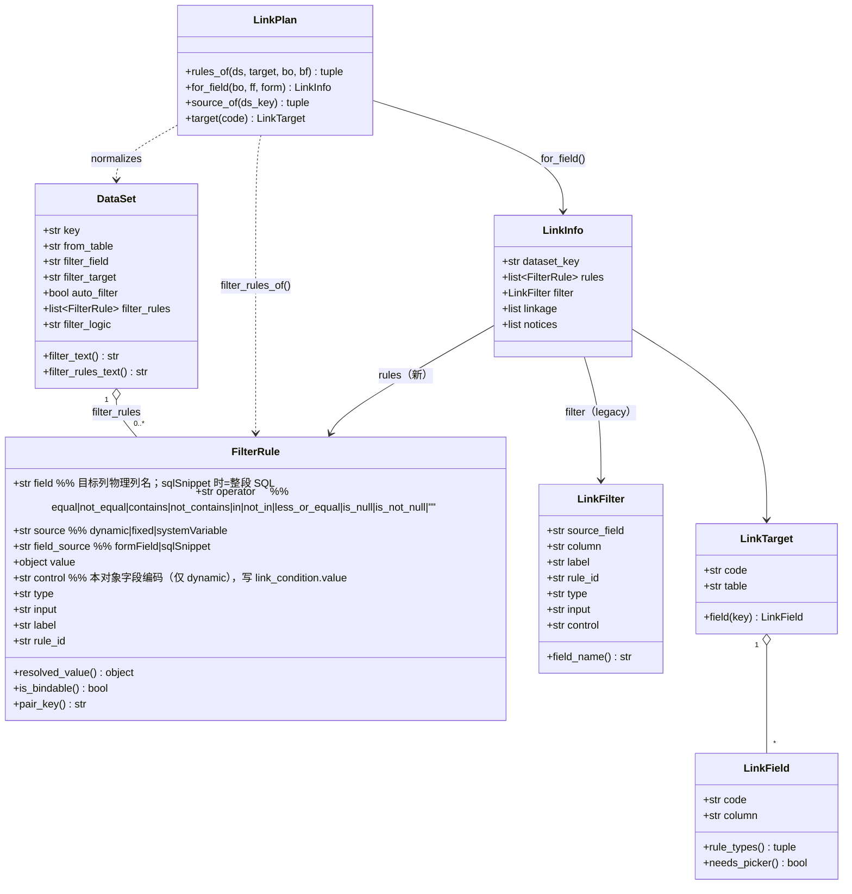
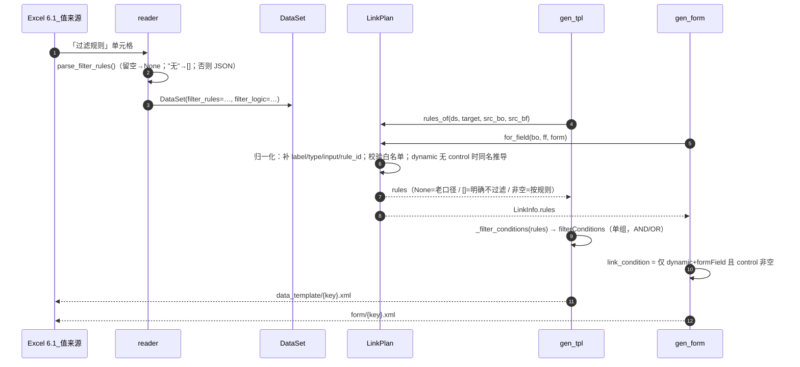
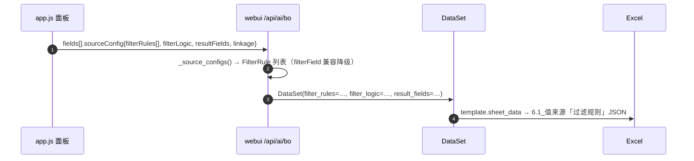
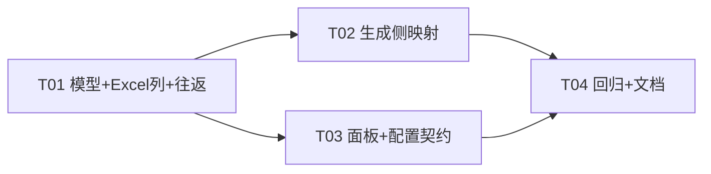

# 架构设计 · 值来源过滤条件的「值来源」自由配置

- 版本：2026-11-20
- 角色：Architect（Bob）
- 关联需求任务：#2「值来源过滤条件支持多种值来源」
- 线上证据来源：只读查询 `powerproject6.iform_data_template_tpl.filter_conditions_`（266 行有过滤条件 / 333 条规则）、`iform_form_field.field_options_`（453 个 linkdata 控件、111 条 link_condition）、`iform_data_template_def`

---

## 第一部分：系统设计

### 1. 实现思路

**核心难点**：今天「一条过滤规则」被硬编码成 `links.LinkFilter`（本对象字段 → 目标列，`source=dynamic` + `field_source=formField`），只能表达线上 4 种真实形态中的 1 种；而线上的规则是**四元组**：`目标列 + 运算符 + 值来源(source) + 值来源载体(field_source) + 值`。

**方案**：
1. 新增 `model.FilterRule`，字段与线上 `filterConditions[].filter.rules[]` **一一对应**，并在构造/归一化时用白名单校验 `(source, field_source)` 组合，**只允许线上出现过的 4 种**：
   `(dynamic, formField)` / `(fixed, formField)` / `(fixed, sqlSnippet)` / `(systemVariable, formField)`。
2. `DataSet.filter_rules: list[FilterRule] | None` 成为唯一真相；`filter_field / filter_target / auto_filter` 原样保留为 legacy 快捷入口。
3. 归一化单点放在 `LinkPlan.rules_of()`（有 project 上下文 + 按 `ds.key` 缓存），`gen_tpl`（值来源侧）与 `gen_form`（表单侧）**读同一份归一化结果**，从结构上保证 `rule_id` 两侧一致。
4. Excel 只加 1 列（JSON），前端面板把单选下拉换成「规则行列表」，两端用同一份 schema。

**无新增第三方依赖**；不引入 ORM/DSL 解析器（Excel JSON 用标准 `json`）。

### 2. 文件清单

| 层 | 文件 | 改动性质 |
|---|---|---|
| 模型 | `pp6kit/model.py` | 新增 `FilterRule`、`RULE_*` 常量、`DataSet.filter_rules/filter_logic/filter_rules_text()` |
| Excel 列 | `pp6kit/spec.py` | `6.1_值来源` 增加「过滤规则」列 |
| 读 | `pp6kit/reader.py` | 解析 `过滤规则` → `filter_rules` |
| 写 | `pp6kit/template.py` | 回写 `过滤规则` |
| 归一化/推导 | `pp6kit/links.py` | 新增 `filter_rules_of()`、`LinkPlan.rules_of()`、`LinkInfo.rules` |
| 值来源出包 | `pp6kit/gen_tpl.py` | `_rule_dict()` / `_filter_conditions()` 支持多规则；`picker_cols` 按规则算 |
| 表单出包 | `pp6kit/gen_form.py` | `_linkdata_options()` 按规则派发 `link_condition` |
| 复用判定 | `pp6kit/blueprint.py` | `_local_value_dataset()` 把带规则的也视为「已过滤」 |
| 前端契约 | `pp6kit/webui.py` | `_source_configs()` / `_apply_source_configs()` 支持 `filterRules` |
| 面板 | `pp6kit/static/app.js`、`pp6kit/static/style.css` | 规则行列表 UI |
| 回归/文档 | `tests/test_value.py`、`tests/test_links.py`、`docs/参考-关联对象值来源-20261119.md` | 断言与说明补章节 |

### 3. 数据结构与接口



**`FilterRule` 定义（字段 / 类型 / 默认值）**

| 字段 | 类型 | 默认 | 说明 |
|---|---|---|---|
| `field` | `str` | `""` | 目标对象**物理列名**（线上 `id`/`field` 同值）。`field_source=sqlSnippet` 时这里放**整段 SQL**（沿用线上形态） |
| `operator` | `str` | `"equal"` | 取值见类图；`sqlSnippet` 固定 `""` |
| `source` | `str` | `"dynamic"` | `dynamic` / `fixed` / `systemVariable` |
| `field_source` | `str` | `"formField"` | `formField` / `sqlSnippet` |
| `value` | `object` | `None` | 见 §5 的 value 映射表；`dynamic` 时被 `resolved_value()` 强制为 `"text"` |
| `control` | `str` | `""` | **本对象**字段编码（表单控件编码）。仅 `dynamic+formField` 使用，写进 `link_condition[].value` |
| `type` | `str` | `""` | 空 = 按目标列推导（`LinkField.rule_types()[0]`） |
| `input` | `str` | `""` | 空 = 按目标列推导（`rule_types()[1]`） |
| `label` | `str` | `""` | 空 = 目标列显示名 |
| `rule_id` | `str` | `""` | 空 = `stable_code(f"{ds.key}:{i}:{field}")`，7 位小写，反复出包不变 |

**多条规则 AND/OR 的表达**：`DataSet.filter_rules`（列表）+ `DataSet.filter_logic: str = "AND"`，落到线上**一个** `filterConditions` 条件组内的 `filter.condition`。依据：线上 263/266 份模板只有 1 个条件组；组内 `condition` 分布 `AND`=269、`OR`=1 —— **OR 合法但罕见，默认 AND**。多组（命名条件，线上各 1 份 3 组/5 组）本期不生成。

### 4. 程序调用流程





### 5. 生成器映射表（模型 → 线上键）

| 模型 / 推导来源 | `filterConditions[].filter.rules[]` 键 | 取值 |
|---|---|---|
| `rule.field` | `id`、`field` | 原样；`sqlSnippet` 时 = 整段 SQL（线上 `id==field==SQL`，58/58） |
| `rule.operator` | `operator` | 原样；`sqlSnippet` → `""` |
| `rule.source` | `source` | `dynamic` / `fixed` / `systemVariable` |
| `rule.field_source` | `field_source` | `formField` / `sqlSnippet` |
| `rule.resolved_value()` | `value` | 见下方 value 表 |
| `rule.label or 目标列.label` | `label`、`origLabel` | 目标列显示名，取不到退列名 |
| `rule.type or rule_types()[0]` | `type` | `string` / `number` / `date` |
| **固定 `"string"`** | `field_type` | 线上 333 条规则 100% 为 `string`（含 number/date 列） |
| `rule.input or rule_types()[1]` | `input` | `text` / `number` / `select` |
| **固定 `"text"`** | `field_input` | 线上 333 条规则 100% 为 `text` |
| `rule.rule_id` 或派生 | `rule_id`、`desc` | 两者同值（线上 95/111 `name==rule_id`） |
| 固定 `""` | `field_date_type`、`field_custom_format`、`date_type`、`custom_format` | 与今天一致 |
| `ds.filter_logic` | `filter.condition` | `AND` / `OR` |
| 今天常量 | 组级 `label`=`默认条件`、`key`=`filter_key(uuid5)`、`type`=`condition`、`rights`=`[{type:all}]`、`addType`=`{isTrusted:true}`、`combinationName`=`""`、`formFieldSource`=`template` | 不变 |

**value 映射**

| `source + field_source` | `value` | 线上依据 |
|---|---|---|
| `dynamic + formField` | **写死 `"text"`**（不接受用户值） | 147+33+11 条全为 `"text"` |
| `fixed + formField` | 字面值原样：`"Y"`、`0`（JSON number）、`"a,b"`（`in` 用逗号串）、`null`（`is_null`/`is_not_null`） | 34+7+1+1+1 条样本 |
| `fixed + sqlSnippet` | `null` | 58 条全 `null` |
| `systemVariable + formField` | 变量名（线上仅见 `currentUserId`） | 3 条 |

**表单侧 `link_condition` 判定表（`gen_form._linkdata_options`）**

| 规则类型 | 是否写 `link_condition` | 依据 |
|---|---|---|
| `dynamic + formField` 且 `control` 非空 | **写一条**，11 键不变：`mode=bind`、`value=control`、`fieldName=<rule_id>_1`、`name=rule_id`、`rule_id`、`desc` | 线上 107 条 `mode=bind`；**`fieldName` 恒为 `<rule_id>_1`**（第 2/3 条也是 `_1`，非索引） |
| `fixed + formField` | **不写** | 同一值来源同时含 dynamic+fixed 的样本：`link_condition` 长度 = 1（只对应 dynamic 那条） |
| `fixed + sqlSnippet` | **不写** | 56 份 sqlSnippet-only 值来源：104 个表单控件查不到绑定 |
| `systemVariable + formField` | **不写**（标「待实测」，见 §10-①） | 仅 3 条，且都在「命名条件组」里，未拿到普通值来源的表单侧样本 |
| `notInputCondition` | **不变**，恒 `conditionIsNone`（今天就这样） | dynamic+fixed 样本即 `conditionIsNone`；线上 90 条 `conditionIsNone` |
| 没有可绑定规则（含 `fixed` only） | `link_condition: []` | 线上 356 个控件 `link_condition` 长度为 0 |

**`rule_id` 生成**：非 dynamic（以及 dynamic 但需派生时）统一 `stable_code(seed)`，`seed = f"{ds.key}:{i}:{rule.field}"`（`i` = 规则在列表中的下标，用于同列多规则去歧）。7 位小写与线上 161/333 的 `len==7` 一致；`dynamic` 规则的 `rule_id` 在归一化时一次定死，`gen_tpl` 与 `gen_form` 都读同一对象，**不依赖执行顺序**（比今天的 `filter_of` 单点派生更强）。

---

## 第二部分：任务分解

### 6. 依赖包

无新增（标准库 `dataclasses` / `json`；前端原生 DOM）。当前依赖保持：`openpyxl`（Excel 读写）、`pymysql`（只读库探测）。

### 7. 任务列表（4 个，按依赖排序）

#### T01 模型 + Excel 列 + 往返读写（P0）
- **文件**：`pp6kit/model.py`（新增 `FilterRule`、`RULE_SOURCE_PAIRS`、`RULE_OPERATORS`、`parse_filter_rules()`、`DataSet.filter_rules/filter_logic/filter_rules_text()`）、`pp6kit/spec.py`（`S_VALUE` 加「过滤规则」列）、`pp6kit/reader.py`（`S_VALUE` 分支解析）、`pp6kit/template.py`（回写该列）
- **依赖**：无
- **要点**：`SheetReader` 对缺失列返回 `None`（已验证只对 `required` 报错），故列必须 `required=False` → 老工作簿 `filter_rules=None`。
- **验证**：① 新单测 `tests/test_value_rules.py`：五种写法（留空 / `无` / 对象 / 裸数组 / 白名单外的组合）读→写→读幂等；② 老工作簿往返出包与 HEAD **逐字节一致**（`tools/regress.py` 476 条基线）。

#### T02 生成侧：归一化 + 值来源/表单两侧映射（P0）
- **文件**：`pp6kit/links.py`（`filter_rules_of()`、`LinkPlan.rules_of()` 缓存、`LinkInfo.rules`、`FilterRule` 归一化）、`pp6kit/gen_tpl.py`（`_rule_dict()` / `_filter_conditions()` 多规则、`picker_cols` 按规则算）、`pp6kit/gen_form.py`（`link_condition` 按规则派发）、`pp6kit/blueprint.py`（`_local_value_dataset` 把有规则的也当「已过滤」）
- **依赖**：T01
- **要点**：legacy 分支保持今天 `LinkFilter` 路径不动（`field_type=filt.type`），新路径 `field_type="string"`；`_rule_dict()` 键顺序与今天完全一致（golden 断言）。
- **验证**：① `tests/test_value.py`、`tests/test_links.py` 全绿；② 新增 4 种形态 XML 快照断言（dynamic/fixed/sqlSnippet/systemVariable 各一）；③ 断言「同一份 Excel 两次出包 `rule_id` 不变」。

#### T03 前端面板 + 后端配置契约（P0）
- **文件**：`pp6kit/static/app.js`（`aiVs*` 面板：规则行列表、值来源四选一、AND/OR）、`pp6kit/static/style.css`（`.ai-vs-rule*` 样式）、`pp6kit/webui.py`（`_source_configs()` 解析 `filterRules`、`_apply_source_configs()` 写 `filter_rules` 并纳入指纹）
- **依赖**：T01（字段名/默认值）
- **要点**：`custom !== true` 语义不变（只忽略 `resultFields`，`filterRules` 与今天的 `filterField` 同等地位）；`filterRules` 缺省 + `filterField` 存在 → 合成为一条 dynamic 规则（老会话不破）。
- **验证**：① 面板手工用例（4 种值来源各走一遍，刷新后面板回显正确）；② `/api/ai/bo` 回传的 xlsx 里「过滤规则」JSON 与面板一致；③ 下载 → 拖回 → 再出包，配置不丢。

#### T04 回归 + 文档（P1）
- **文件**：`tests/test_value_rules.py`（新建，端到端 4 形态 + 兼容用例）、`tests/test_links.py`（补 `link_condition` 只含 dynamic 的断言）、`docs/参考-关联对象值来源-20261119.md`（§2.3 补四种形态与字段表）、`README.md`（「6.1_值来源」列说明补「过滤规则」）
- **依赖**：T02、T03
- **验证**：`tools/regress.py` 全量；出包后人工核对一份含 4 种规则的包在测试环境导入无报错（**需要线上环境实测，见 §10**）。

### 8. 共享知识（跨切面约束）

1. **红线**：只生成线上出现过的 4 种 `(source, field_source)` 组合；白名单外的写法**报错**，不猜、不降级。
2. **`rule_id` 同一性**：`dynamic` 规则的 `rule_id` 必须与表单 `link_condition[].rule_id` 一致 —— 唯一保证手段是两侧读**同一个 `FilterRule` 对象**（`LinkPlan.rules_of()` 缓存），禁止各算一遍。
3. **`value="text"` 只属于 `dynamic+formField`**；`fixed` 的 `value` 是字面值（number 列要保持 JSON number，不要转字符串）。
4. **`field_type`/`field_input` 恒 `string`/`text`**（新路径）；`type`/`input` 才随列类型变。
5. **legacy 优先级**：`filter_rules is None` → 老口径（`filter_field`/`filter_target`/`auto_filter`/同名推导）；`filter_rules == []`（Excel 写 `无`）→ **一条过滤都不要**；非空 → 完全按规则，忽略 legacy 三件套。
6. 同一 `(目标对象 + 规则集 + 返回列)` 复用同一份值来源；规则不同必须另起 `<key>_2`（`_apply_source_configs` 指纹要含规则）。
7. 日期/时间统一 ISO 8601（与现有出包一致，本期不涉及时间字段）。

### 9. 任务依赖图



---

## 第三部分：Excel / 面板 / 兼容性细则

### 10. Excel 列设计（`6.1_值来源`）

| 表头 | key | 宽 | 必填 | 说明 |
|---|---|---|---|---|
| `过滤规则` | `filter_rules` | 46 | 否 | JSON。**留空 / 列不存在 = 现有行为**；`无` = 明确不要任何过滤；其余按 JSON |

位置：放在「过滤目标」之后、「自动」之前（`SheetReader` 按表头名取值，位置不影响解析）。

**JSON schema（单元格内）**

```json
{
  "logic": "AND",                     // 可选，默认 AND；AND|OR
  "rules": [
    {
      "field": "classification_id_",  // 必填：目标对象物理列名；sqlSnippet 时=整段 SQL
      "operator": "equal",            // 可选，默认 equal
      "source": "dynamic",            // 可选，默认 dynamic：dynamic|fixed|systemVariable
      "field_source": "formField",    // 可选，默认 formField：formField|sqlSnippet
      "value": null,                  // fixed=字面值；systemVariable=变量名；dynamic 忽略
      "control": "xiangMuLeiXing",    // 仅 dynamic：本对象字段编码（表单控件）
      "type": "string",               // 可选，默认按目标列
      "input": "text",                // 可选，默认按目标列
      "label": "项目类型",             // 可选，默认目标列显示名
      "rule_id": ""                   // 可选，默认派生
    }
  ]
}
```

**填写示例**

1) 固定值（单条）——「只要有效的」
```json
{"logic":"AND","rules":[{"field":"is_active_","operator":"equal","source":"fixed","value":"Y"}]}
```

2) 表单控件 + 固定值（两条 AND）——「按项目类型筛、且只要有效的」
```json
{"logic":"AND","rules":[
  {"field":"classification_id_","operator":"equal","control":"xiangMuLeiXing"},
  {"field":"is_active_","operator":"equal","source":"fixed","value":"Y"}]}
```

3) SQL 片段（`{{params:xxx}}`）
```json
{"logic":"AND","rules":[{"field":"project_id_ = {{params:objectId}}","operator":"","source":"fixed","field_source":"sqlSnippet","value":null}]}
```
> 多行 SQL 在 JSON 里必须写 `\n` 转义；建议写单行。

4) 系统变量——「责任人是当前用户」
```json
{"logic":"AND","rules":[{"field":"person_ids_","operator":"contains","source":"systemVariable","value":"currentUserId"}]}
```

5) 数字列 + `less_or_equal` / `in`
```json
{"logic":"AND","rules":[
  {"field":"plan_state_","operator":"less_or_equal","source":"fixed","value":1,"type":"number","input":"number"},
  {"field":"requirement_type_","operator":"in","source":"fixed","value":"systemRequirement,MRDRequirement"}]}
```

**留空规则**：`过滤规则` 留空（或老工作簿没有这一列）→ `filter_rules=None` → **完全走今天的逻辑**（`过滤字段`/`过滤目标`/`自动` + 同名推导），产物逐字不变。

### 11. 面板设计（`app.js` 值来源浮层）

```
值来源 · 所属项目 → 项目
┌ 过滤规则   逻辑 (•)且 ( )或                        [+ 添加规则]
│ ┌───────────────────────────────────────────────────────────┐
│ │ 字段 ▾       运算符 ▾     值来源 ▾        值              × │
│ │ 项目类型     等于          表单控件 ▾      [项目类型 ▾]      │
│ │ 是否有效     等于          固定值 ▾        [ Y        ]     │
│ └───────────────────────────────────────────────────────────┘
返回结果（勾选 / 联动，保持现状）
```

| 段 | 控件 | 取值来源 |
|---|---|---|
| 字段 | select | `state.objFieldCache[target].fields`（排除 `system` 列；`field` 存物理列名） |
| 运算符 | select | 按列 `type` 分档：`equal/not_equal/contains/not_contains/in/not_in/less_or_equal/is_null/is_not_null`（全部取自线上枚举） |
| 值来源 | select | 4 项，映射：表单控件→`dynamic/formField`、固定值→`fixed/formField`、SQL 片段→`fixed/sqlSnippet`、系统变量→`systemVariable/formField` |
| 值 | 随值来源切换 | 表单控件→本表单字段下拉（object 字段优先，`value` 存字段编码=控件编码）；固定值→输入框；SQL 片段→多行文本（写进 `field`，`operator` 置空）；系统变量→可输入 + `datalist`（默认仅 `currentUserId`）；`is_null`/`is_not_null` → 禁用 |

`sourceConfig` JSON（前端 → 后端）

```json
{
  "custom": true,
  "resultFields": ["id", "name", "zhuan_ye_"],
  "linkage": [{"name": "zhuan_ye_", "field": "zhuanYe", "label": "专业"}],
  "filterLogic": "AND",
  "filterRules": [
    {"field": "classification_id_", "label": "项目类型", "operator": "equal",
     "source": "dynamic", "fieldSource": "formField", "control": "xiangMuLeiXing"},
    {"field": "is_active_", "label": "是否有效", "operator": "equal",
     "source": "fixed", "fieldSource": "formField", "value": "Y"}
  ]
}
```

- 前端用 `fieldSource`（避免 JS 里 `source` 二义），后端同时接受 `fieldSource` / `field_source`。
- **`custom !== true` 语义不变**：不采信 `resultFields`；`filterRules` 与今天的 `filterField` 同级（用户不操作面板就不会出现）。
- 兼容：`filterRules` 缺省而 `filterField` 非空 → 后端合成一条 `dynamic` 规则（`field` 由同名推导，`control=filterField`）。
- 「不过滤」= `filterRules: []` → 写 `filter_rules=[]` → 不出 `filterConditions`（顺带修掉今天「面板选不过滤但仍可能走同名推导」的隐患）。

### 12. 向后兼容矩阵

| 场景 | `filter_rules` | legacy 三件套 | 结果 |
|---|---|---|---|
| 老 Excel（无新列）/ 没配 | `None` | 有 | 走 `filter_of()`，**产物逐字不变** |
| 老 Excel，`过滤字段=无` | `None` | `auto_filter=False` | 不出 `filterConditions`（不变） |
| 新 Excel，`过滤规则=无` | `[]` | 忽略 | 不出 `filterConditions` |
| 新 Excel，有规则 | 非空 | **忽略**；不写回 `filter_target` | 按规则生成（单组 + AND/OR） |
| 有规则但目标列解析不到 | 非空 | — | 丢弃该条 + notice（同今天「找不到列→已按不过滤生成」口径） |
| `dynamic` 规则缺 `control` | 非空 | — | 先按同名推导（`auto_filter`）；仍失败 → 丢弃该条 + notice |

### 13. 风险与待确认（5 条）

| # | 待确认点 | 我的默认判断 | 不确认会怎样 |
|---|---|---|---|
| ① | `systemVariable` 规则在**表单侧**要不要写 `link_condition` | 不写（与 `fixed` 同处理） | 线上仅 3 条 `systemVariable`，且都在「命名条件组」里，拿不到普通值来源的表单侧样本。若系统其实要求写（例如 `mode=fixed` + 变量名），则「责任人=当前用户」这类条件导入后不生效，而下拉看着正常——静默失效 |
| ② | `field_type` 是否必须恒为 `string`（新路径这样写，legacy 仍写 `type`） | 恒 `string`（线上 333/333）；legacy 不动 | 若系统按 `field_type` 决定算子集合：数字/日期列过滤可能退化成文本算子。需要出一包**数字列过滤**实测 |
| ③ | 规则的 `id`/`field` 是否允许带表名前缀（线上 20/333 是 `pp_issue.category_id_`） | 本期只生成不带的 | 若用户要 SQL 片段做跨表 join（别名 `a.` / `b.`），模型表达不了，只能靠用户在 `field` 里直写——与「不臆造形态」冲突，需要线上样本确认 |
| ④ | 「命名条件组」（一个值来源挂多个 `filterConditions` 组：任务/流程/我待办的）是否也要支持 | 本期不做（只生成 1 组） | 线上确有（1 份 3 组 / 1 份 5 组），用户可能以为「多条规则」=「多组命名条件」。若他要的是按入口切换的过滤集，这是另一个需求 |
| ⑤ | 面板「不过滤」的旧口径变化 | 改为显式 `filter_rules=[]`（不再走同名推导） | 今天面板选「不过滤」后仍可能被 `auto_filter` 同名推导补一条规则（潜在旧 bug，触发条件很窄：本对象有另一个同显示名的关联字段）。若有人依赖这个行为，产物会从"有过滤"变"无过滤" |
