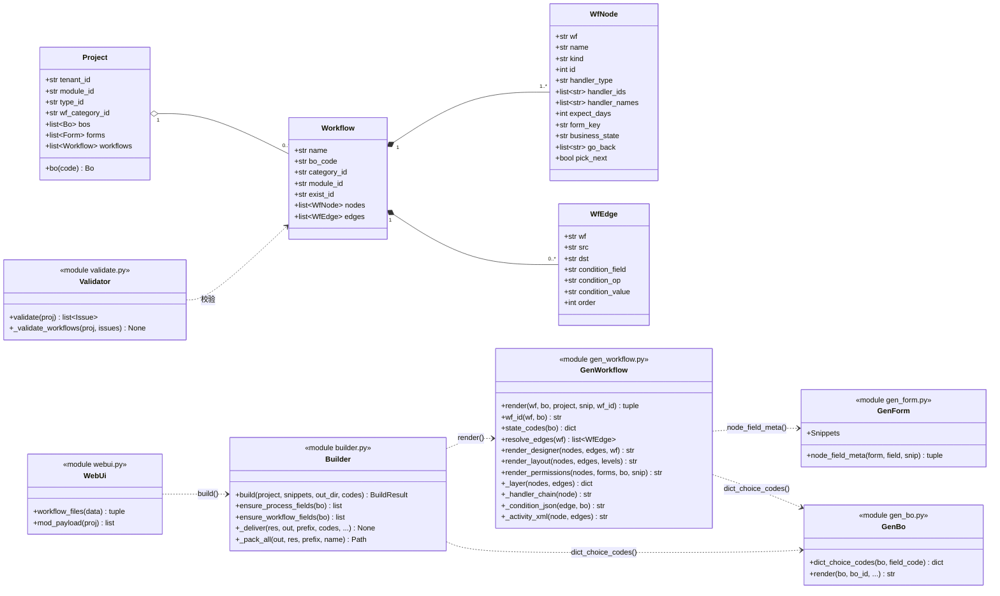
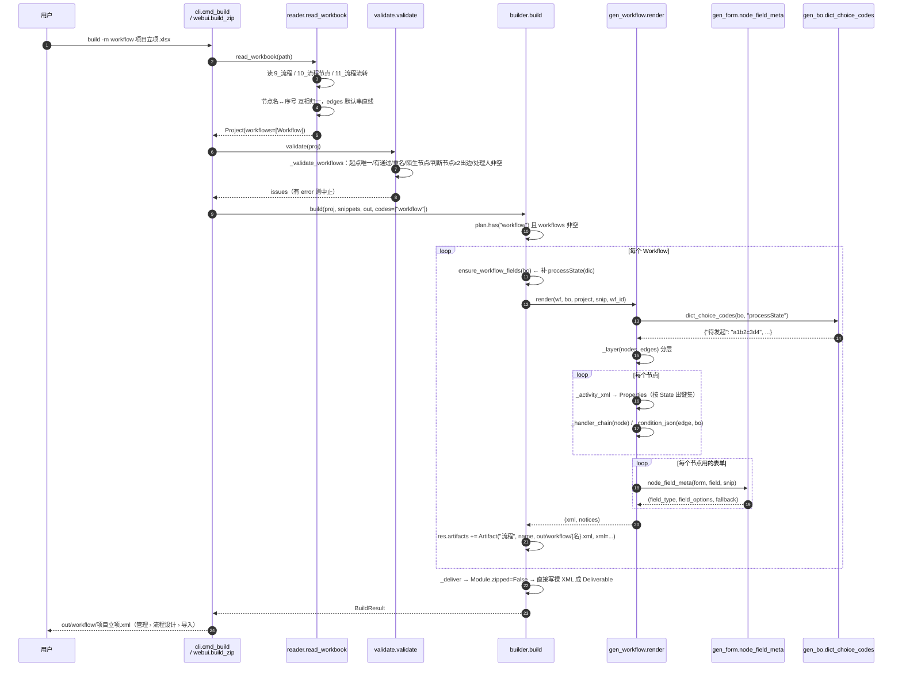
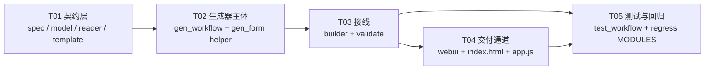

# 流程生成能力 —— 架构复核与实现任务书

> 上游输入：`docs/流程-分析.md`（XML 七段结构）、`docs/流程生成-设计.md`（三张表 + 生成规则）。
> 本文档做三件事：**逐条复核设计与真实代码/真实 XML 的冲突并给出结论** → **更正设计里的错误** →
> **给出可直接照做的 5 条实现工序（T01–T05）**。
>
> 复核基准（按优先级）：
> 1. 真实样本 `PP6/流程/项目立项_20261113145550.xml` 的 **v30 那一版**（`DefaultFlowChartVersion="30"`，
>    也就是用户线上正在跑的那一版）；
> 2. `PP6/流程/config-sync-20261113150255.zip` 里的 `bo/001-project_create.xml` + 两张表单；
> 3. 现有代码（`spec/model/reader/builder/validate/gen_bo/gen_form/template/webui/static`）。
>
> v1–v29 只用来判断「某个键是必需还是可选」，**不作为输出基准**。

---

## 一、复核结论（team-lead 点名必须回答的 5 条）

### D1 `builder._deliver()` 对所有模块都调 `_pack_module`，workflow 是裸 XML，怎么改最小？

**结论：用 `modules.Module.zipped` 分流，不要写 `if code == "workflow"`。**

`modules.py:64` 已经把这件事建模过了：

```python
zipped: bool = True    # 流程是裸 XML，不打 zip
Module("workflow", "流程", "workflow", "管理 › 流程设计 › 导入", 50, ..., zipped=False)
```

现在 `_deliver()`（`builder.py:325-338`）无视了这个字段。最小改法：

```python
def _deliver(res, out, prefix, codes, label="", stamp=""):
    for code in codes:
        items = res.of_module(code)
        if not items:
            continue
        mod = mod_def.of(code)
        if not mod.zipped:
            # 裸 XML：产物文件在生成阶段就已经写好了（out/workflow/{名}.xml），
            # 这里只包成 Deliverable，**不要再写一遍**，避免两处路径各写一次后漂移
            for a in items:
                res.deliverables.append(Deliverable(
                    module=code, label=mod.label, filename=a.zip_path.name, path=a.zip_path,
                    items=[a], menu=mod.menu))
            continue
        name = package_name(label, mod.label, stamp) if label else None
        packed = _pack_module(out, code, items, prefix, name)
        ...
```

配套四点（都不是可选的）：

0. 生成阶段就把裸文件落盘（`builder.py` 加一个 3 行 helper，紧挨 `_write_zip` 放）：

   ```python
   def _write_plain(out_dir: Path, filename: str, content: str) -> Path:
       out_dir.mkdir(parents=True, exist_ok=True)
       path = out_dir / filename
       path.write_text(content, encoding="utf-8")
       return path
   ```

1. `_pack_all()`（`builder.py:283`）**必须**在「实际写入 0 个条目」时返回 `None`。
   现在它只看 `if not res.artifacts: return None`，而 workflow 虽然会被 `if mod == "workflow": continue`
   跳过，**却仍然让 `res.artifacts` 非空** → 会生成一个 0 条目的空 zip。加一个 `written = 0` 计数器，
   写完 `if not written: target.unlink(missing_ok=True); return None`。
   （`BLD14 包内没有空目录` 不覆盖这种「空 zip」，所以必须靠新用例守。）
2. `webui.build_zip()`（`webui.py:378-381`）的 `src = allp.path if allp else 第一个 deliverable`
   在「只选了流程」时会拿到一个 `.xml`，接着 `zipfile.ZipFile(src)` 抛 `BadZipFile` →
   前端只看到「File is not a zip file」。必须前置判断，见 D3。
3. `Artifact` 的 `zip_path/entry` 对裸 XML 没意义：`zip_path` 填那个 `.xml` 的路径、`entry=""`、
   `xml=文本`。这样 `Deliverable.bytes`（`path.stat()`）、`by_kind()`、报告里的 `· 流程 xxx` 全部照旧可用。

### D2 `builder.build()` 里 `plan.has("workflow")` 现在会 push 一条「生成器不做流程」的 notice，怎么处理？

**结论：整条删掉，换成「要么真生成、要么说清为什么没内容」，并且要处理「选了流程但没填 9_流程」这一档。**

现在 `builder.py:355-357`：

```python
# 流程不在生成器里做（需要流程设计器导出的定义），只提示
if plan.has("workflow"):
    res.notices.append("流程定义请在「流程设计」里导出 XML 后原样上传，生成器不做流程")
```

替换为（放在 `blueprint.expand(project)` 之后、业务对象循环之前，因为流程要按对象名/表单 key 推导默认值）：

```python
# 流程：按 9_流程 / 10_流程节点 / 11_流程流转 三张表生成 workflowDefinition（裸 XML）
if plan.has("workflow"):
    if not project.workflows:
        res.notices.append("选了「流程」但 9_流程 是空的，跳过流程生成")
```

真正的生成放在 `---- 列表` 之后、`_deliver` 之前（那时 `form_of_bo / detail_of_bo` 都已就绪）：

```python
if plan.has("workflow"):
    for wf in project.workflows:
        bo = project.bo(wf.bo_code)
        if bo is None:
            res.notices.append(f"流程 {wf.name}: 对象 {wf.bo_code} 不存在，已跳过")
            continue
        xml, notices = gen_workflow.render(wf, bo, project, snip, gen_workflow.wf_id(wf, bo))
        res.notices.extend(notices)
        folder = out / mod_def.of("workflow").folder           # out/workflow/
        path = _write_plain(folder, f"{safe_filename(wf.name)}.xml", xml)
        res.artifacts.append(Artifact("流程", wf.name, path, "",
                                      len(xml.encode("utf-8")), "workflow", xml))
        res.notices.append(f"流程 {wf.name}: 已生成 {len(wf.nodes)} 个节点，"
                           f"导入位置 {mod_def.of('workflow').menu}")
```

注意 **`need_bo_rows`（`builder.py:396`）现在不含 workflow**：只选流程时不会补系统字段/流程字段，
也不会生成 bo XML——这是**正确**的（用户多半只想要流程 XML，对象早就在系统里）。
但 `processState` 的短码必须和对象里的一致，所以流程侧的短码计算**不能**依赖「bo XML 是否生成」，
要依赖模型里的字段（见 D4）。

### D3 流程 XML 怎么交付给用户？评估 `POST /api/workflow` + `pack-bar` 新按钮 vs 更小的改法

**结论：保留设计里的 `POST /api/workflow`；被评估过的「更小改法」有硬缺陷，否决。**

先说**为什么不能塞进 `/api/build` 的那个 zip**：`modules.py:34` 与 `builder.py:296` 两处注释已定死
「流程是裸 XML，不进这个包（系统的流程导入是另一个入口）」，`_pack_all` 里也有 `if mod == "workflow": continue`。
塞进去会让整包导入报「不支持的同步对象类型」。这条不动。

**方案 A（设计原方案，采纳）**：新增 `POST /api/workflow`。

- 后端新增薄函数（`webui.py`，紧挨 `import_module()` 放）：

  ```python
  def workflow_files(data: bytes) -> tuple[bytes, str, str]:
      """流程是裸 XML：一条流程回一个 .xml，多条回一个 zip（内含 {流程名}.xml）。
      返回 (body, filename, content_type)。"""
  ```

  单条 → `application/xml` + `{流程名}.xml`；多条 → `application/zip` + `{业务名}-流程-N条-{日期}.zip`。
  路由直接 `self._send(200, body, ctype, name)`（`_send` 已支持中文文件名 RFC 5987 编码，`WEB20` 覆盖）。
- 前端：`static/index.html` 的 `pack-bar`（第 335-338 行）把现有按钮**包一层**再追加一个按钮：

  ```html
  <div class="pack-bar">
    <span class="sub" id="packHint">…</span>
    <div class="ai-btns">
      <button class="btn ghost" id="btnWorkflow" hidden>下载流程 XML</button>
      <button class="btn primary" id="btnPack">下载导入包 zip</button>
    </div>
  </div>
  ```

  `.ai-btns { display:flex; gap:8px }`（`style.css:1001`）已存在，**零 CSS 改动**；
  `patch-bar`（`index.html:479-486`）已经是「span.sub + .ai-btns 多按钮」这个形状，属于既有结构，不是新发明。
- 冲突检查（逐条）：
  - `updateBar()` 只操作 `$("#btnPack") || $("#btnBuild")` 和 `#barSummary/#barHint`，
    新增按钮不在选取范围 → 不会互相踩。
  - `buildZip()` 的 `finally` 只恢复它自己那个按钮 → 无影响。
  - `state.picked` 里含 `workflow` 时 `buildZip` 仍会发出 `X-Modules: [... "workflow"]`，
    后端 `build()` 会正常生成流程 XML 但**不放进 zip**，zip 里没有流程条目 → 行为正确，
    只是 toast 里的「已导出 N 个模块」会把流程也算进去。**接受**（多一句不精确的话，胜过动 3 个函数）。

**方案 B（被否决的更小改法）**：复用现成的 `POST /api/import/<code>` 路由 + 放开 `renderModules`
里 `flowHint` 对 workflow 行的禁用（`app.js:330,355,358`）。改动量确实更小（后端 2 行 ctype 判断 + 前端 3 行），
但 `import_module()`（`webui.py:561-576`）只 `return d.path.read_bytes()` 拿 **`res.deliverables[0]`**，
`9_流程` 是多行表 → **多流程时静默只下载第一条**。要修就得让 import_module 懂「多流程打包」，
那等于把方案 A 的后半段又实现一遍，还污染了「单模块单包」的语义。**否决**，记在此处避免以后有人重走。

**方案 C（否决）**：把流程 XML 放进 `out/workflow/` 就完事、不给 HTTP 通道。桌面壳用户能用，
但 Web 端（`webui.serve`）用户拿不到，等于功能半残。

**`build_zip()` 的兜底文案（必须加）**：当所有 deliverable 都不是 zip（即只选了流程）时：

```python
if not any(d.module == "all" or mod_def.of(d.module).zipped for d in res.deliverables):
    raise ValueError("流程是裸 XML，不走同步包：请点「下载流程 XML」，"
                     "或到 管理 › 流程设计 › 导入 单独上传")
```

### D4 `processState` 按需补第 5 个字段，怎么改才不破 RDR22 / BO17？

**结论：不改 `ensure_process_fields` 的默认语义，另开一个 `ensure_workflow_fields()`。**

两个用例的实际约束：

| 用例 | 断言 | 是否会被第 5 个字段打破 |
|---|---|---|
| `tests/test_reader.py::RDR22` | 直接调 `builder.ensure_process_fields(bo)`，断言 `len(added) == 4` | **会**（只要默认行为变了就红） |
| `tests/test_bo.py::BO17` | 只断言 4 个 code 在 XML 里 `in codes`（子集检查） | 不会 |

所以：

```python
# builder.py
PROCESS_STATE_OPTIONS = ["待发起", "进行中", "已完成", "已失败"]

def ensure_workflow_fields(bo: Bo) -> list[str]:
    """流程驱动且本包里有流程时，再补第 5 个 processState（流程状态，dic）。

    为什么单独一个函数而不是改 ensure_process_fields 的默认：
    tests/test_reader.py::RDR22 直接调后者并断言 len(added)==4，
    把默认行为改成 5 会连别人的用例一起改；而「有没有流程」是 Project 级信息，
    Bo 自己不知道，所以判据留在调用方。
    """
    if not bo.flow_driven:
        return []
    if bo.field_by_code("processState") is not None:
        return []
    sn = max([f.sn for f in bo.fields], default=0) + 1
    bo.fields.append(BoField(
        bo_code=bo.code, code="processState", name="流程状态", type_new="dic",
        length=64, sn=sn, choices=list(PROCESS_STATE_OPTIONS),
    ))
    return ["processState"]
```

调用点（`builder.build()`，必须在 `ensure_system_fields()` 与 `gen_bo.render()` **之前**，
否则 `_dict_blocks` 扫不到这个 dic 字段、字典不会进 bo XML）：

```python
wf_bos = {w.bo_code for w in project.workflows}
for bo in project.bos:
    ...
    if bo.code in wf_bos:
        extra = ensure_workflow_fields(bo)
        if extra:
            res.notices.append(f"业务对象 {bo.code}: 有流程，已补流程状态字段 {', '.join(extra)}")
```

三个必须记住的细节：

1. `PROCESS_FIELDS` 里 4 个字段是 varchar，`processState` 是 **dic**，所以要 `choices=`，
   否则 `gen_bo._dict_blocks` 会出一个空字典（→ 流程 BusinessState 找不到短码）。
2. `sn` 用 `max+1` 递增，插在 4 个流程字段之后（原生包是 `processDefId(29) → processInstanceId(30) →
   processNode(31) → processHandler(32) → processName(33) → processState(34) → processCode(35)`；
   我们顺序略不同，但 `sn` 只决定界面顺序，不影响导入）。
3. 短码一律走 `gen_bo.dict_choice_codes(bo, "processState")`（**公开函数**，`gen_bo.py:392`），
   它内部与 `_dict_blocks` 用同一套 `_choice_code(scope=dict_key)`，所以流程里的 `BusinessState`
   与 bo XML 里的字典 key **天然一致**。

> ⚠ 真实风险（写进「待明确」第 3 条）：线上已有对象的 `processState` 字典短码是系统随机分配的
> （实测 `待发起=f9cd5a6d`，而 md5 算法算出的是 `403e6f64`）。所以我们**能保证自己出的包内部一致**，
> 但**不能**保证与线上已有对象的字典一致。走「更新已有对象」路线时这会让流程状态与列表筛选值错位。

### D5 `gen_workflow` 直接 import `gen_form` 的私有名，可接受吗？

**结论：不接受「散着 import 三个私有名」；在 `gen_form` 里加一个公开薄封装，成本 12 行。**

设计 §3.6 写的是：

```python
parents = gen_form._cascade_parent_names(form)
ftype   = gen_form._effective_type(ff, parents)
opts, _ = snippets.field_options(ftype)
fo      = gen_form._apply_options(opts, ff, parents)
```

理由不成立的地方：这四个值**必须由同一次推导产生**（`parents` 决定 `_effective_type`，`_effective_type`
决定取哪份 `fieldOptions` 骨架，`_apply_options` 再拿 `parents` 决定级联形态）。散着调用等于在
`gen_workflow` 里复制一份 `gen_form.render()` 第 667/743/756/761 行的调用序列——**将来 gen_form 改了签名，
这里不会报错，只会静默生成与表单不一致的 field_options**，而 nodePermissions 与表单控件参数不一致正是
「节点上字段全消失」的成因（分析文档 §2 第 6 行）。

做法：

```python
# gen_form.py，放在 _apply_options 之后
def node_field_meta(form: Form, field: FormField, snip: "Snippets") -> tuple[str, dict, bool]:
    """给「流程节点字段权限」用的控件快照：(真正写进 XML 的控件类型, fieldOptions, 是否兜底)。

    为什么在这里而不是让 gen_workflow 自己拼：
    nodePermissions 里的 field_type / field_options 必须与 form 里那个控件**逐键一致**，
    而「级联父级集合 → 有效类型 → 取哪份骨架 → 应用级联形态」是一条链，
    拆到别的模块去复制这条链，改签名时不会报错、只会静默漂移。
    """
    parents = _cascade_parent_names(form)
    ftype = _effective_type(field, parents)
    base, fallback = snip.field_options(ftype)
    return ftype, _apply_options(base, field, parents), fallback
```

`gen_workflow` 只 `from .gen_form import node_field_meta`（外加已经公开的 `Snippets`、`_span_of` 不用）。

---

## 二、设计文档的错，以真实 XML 为准逐条更正

复核时把 v30 的 13 个节点、15 条流转、58 项 nodePermissions 全量解析了一遍。
下面 9 条与 `docs/流程生成-设计.md` 不符，**全部按真实 XML 更正**（证据附在括号里）。

| # | 设计文档写的 | 真实 XML（v30） | 处置 |
|---|---|---|---|
| 1 | Start 节点 `ColorCode=7` | **v30 开始节点没有 ColorCode**（v1–v10 的 5 节点旧图有 `7`；v11–v30 共 20 版都没有） | **不写** ColorCode。理由：以 v30 为基准，且它是纯画布配色。若导入后配色异常，加一行 `ColorCode=7` 即可 |
| 2 | Rejected「同 Passed，但无 `IfShowButtonOfAddReader`」 | **反了**：Rejected 有 `IfShowButtonOfAddReader=false`，**没有** `IfShowButtonOfSaveForm` | 按真实键序出：`BeforeCompleteEvents / AfterEnterEvents / BusinessState / FormKey / ColorCode(8) / BeforeEnterEvents / AfterCompleteEvents / IfShowButtonOfAddReader` |
| 3 | `Order` 同一源节点内按行序 `1..N` | **判断节点**才 `1..N`；**普通节点固定 `Order="0"`**（v30 的 T1/T2/T6/T7/T10/T13/T14/T15/T18 全是 0） | 普通节点写 0，判断节点出边从 1 递增 |
| 4 | Ongoing 必带 `GoBackConfig` + `ReviewBusinessParams` | 两者都**可选**：30 版里有 56 个 Ongoing 两个都没有；`GoBackConfig` 只在配过「退回意见必填」时出现 | 按 v30 出（两个都带）。写进「待明确」第 4 条：`GoBackConfig` 是可选键 |
| 5 | `GoBackActivityIds` 留空 = 本节点之前所有 `Ongoing` 节点 | 样本含**开始节点**，且**跳过判断节点**：`node2=[1]`、`node10=[1,2,3,8]`（跳过 Branch 7/9）、`node14=[1,2,3,6,12]` | 规则改为「之前所有 **NormalActivity**（含 Start，不含 Branch）」 |
| 6 | `GoBackConfig` 例 `{"1":true,"2":true}` | 键序是**字符串字典序**：`{"1":true,"12":true,"2":true,"3":true,"6":true}`（node14 实证） | 生成时用 `sorted(ids, key=str)`，与样本字节一致 |
| 7 | Transition 子元素固定 5 个 | 判断节点出边**没有** `IfHideAttachment`；源自 Ongoing 的出边**多** `NotAllowManualTransform=false`（插在 `IfHideCC` 之后、`PostTransformEvents` 之前） | 按「源节点种类」出：Start/Ongoing → `IfHideComment/PreTransformEvents/IfHideAttachment/IfHideCC/[NotAllowManualTransform]/PostTransformEvents`；Branch → `IfHideComment/PreTransformEvents/IfHideCC/PostTransformEvents` |
| 8 | 「节点 id 连续」 | 样本 activity Id 不连续（v30 是 `1,2,3,4,6,7,8,…,14`，缺 5，是删过节点）；**Transition Id 是独立序列** `1..18`，与 activity Id 不同源 | 我们出**连续** activity Id `1..N`（自己的约定，系统不要求连号），Transition Id 另起 `1..M` |
| 9 | nodePermissions「容器（fieldset/card）不写进去」 | **容器是写进去的**：58 项 = `_p_title` + 60 个 formField − 3 个 `grid_layout`，即 6 个 `fieldset_xxxxxx` **在**里面，`grid_layout` 不在；`column` 只有开始节点有 22 项（明细表列） | 我们**不写容器、`column` 恒 `[]`**（理由：容器名是 `gen_form` 构建期 `short_id()` 随机生成的，workflow 侧无法复现；明细表列来自列表模板，同理）。这是**已知偏离**，见「待明确」第 1 条 |

另外 3 条是分析文档（`流程-分析.md`）的笔误，不影响生成但会误导后来人：

- §1.4 表格里 Start 的 `ColorCode=7`（同上第 1 条）；
- §2 末段「开始节点的 `project_create_start` 在 zip 里根本没有」——那是 v1–v10 的值；
  **v30 用的是 `project_create_`，zip 里有这张表单**，所以 FormKey 是硬依赖不是软依赖；
- §1.2「NormalActivity 10 个 / BranchActivity 3 个」正确，但没说 **activity Id 不连续**。

还有 3 条设计文档没写、但实现时必须知道的格式细节：

- **文件开头没有 `<?xml ... ?>` 声明**：样本第一行直接是 `<workflowDefinition>`（`gen_bo` 用的
  `DECL_PLAIN` 在这里**不能加**）。
- `layout` 里 **node key 与 link key 是两套独立的 `-1..-N` 序列**（都从 -1 起）；
  `points` 是 **4 个数字的扁平数组** `[x1,y1,x2,y2]`，不是点对数组；`loc` 是 `"x y"` 字符串。
- `layout` 数组的顺序：样本是 v30→v1 倒序。我们只出一版，`[{"nodeDataArray":…,"linkDataArray":…,"version":1}]`
  且 `FlowChart Version="1"`、`DefaultFlowChartVersion="1"`。（样本 30 版是编辑器历史，见分析 §1.1）

---

## 三、最终设计

### 3.1 数据模型（在 `model.py` 追加，风格照既有 dataclass）

```python
WF_START, WF_ONGOING, WF_BRANCH, WF_PASSED, WF_REJECTED = (
    "Start", "Ongoing", "Branch", "Passed", "Rejected")

WF_KIND_BY_LABEL = {"开始": WF_START, "审批": WF_ONGOING, "判断": WF_BRANCH,
                    "通过": WF_PASSED, "驳回": WF_REJECTED, "不通过": WF_REJECTED}

# 业务状态：固定 4 个，与 processState 的选项**同名**（短码靠 dict_choice_codes 换算）
WF_STATE_BY_KIND = {WF_START: "待发起", WF_ONGOING: "进行中",
                    WF_PASSED: "已完成", WF_REJECTED: "已失败"}

# 各 State 的默认画布颜色（样本实测：Ongoing=1 / Branch=2 / Passed=3 / Rejected=8）
# ⚠ Start 故意不在表里：v30 开始节点**没有** ColorCode（第二节第 1 条），
#   要改回「写 7」只需在这里加一行 WF_START: "7"，其余代码不用动
WF_COLOR = {WF_ONGOING: "1", WF_BRANCH: "2", WF_PASSED: "3", WF_REJECTED: "8"}

WF_COND_LABEL = {"等于": "equal", "不等于": "not_equal", "大于": "greater",
                 "大于等于": "greater_or_equal", "小于": "less", "小于等于": "less_or_equal",
                 "属于": "in", "为空": "is_empty", "不为空": "is_not_empty"}

@dataclass
class WfNode:
    wf: str
    name: str
    kind: str = WF_ONGOING
    id: int = 0                       # 0 = 按行序自动 1..N
    handler_type: str = "角色"        # 角色 / 人员 / 无
    handler_names: list[str] = field(default_factory=list)
    handler_ids: list[str] = field(default_factory=list)
    expect_days: int = 2
    form_key: str = ""                # 空 = 自动（开始→新建表单，其余→详情表单）
    business_state: str = ""          # 空 = 按 kind 推导
    go_back: list[str] = field(default_factory=list)   # ["无"] = 不允许退回
    pick_next: bool = False
    allow_handover: bool = False
    color: str = ""
    notes: str = ""

@dataclass
class WfEdge:
    wf: str
    src: str
    dst: str
    name: str = ""
    condition_field: str = ""
    condition_op: str = ""
    condition_value: str = ""
    value_label: str = ""
    order: int = 0
    inform: bool | None = None

@dataclass
class Workflow:
    name: str
    bo_code: str
    workflow_type: str = "normal"
    category_id: str = ""
    module_id: str = ""
    title_format: str = "${name}-${bo.name}-${bo.createBy}-${bo.createTime}"
    is_active: bool = True
    desc: str = ""
    exist_id: str = ""
    nodes: list[WfNode] = field(default_factory=list)
    edges: list[WfEdge] = field(default_factory=list)
```

`Project` 追加两个字段（`workflows` 与设置项）：`workflows: list[Workflow]`、`wf_category_id: str = ""`。

### 3.2 类与函数关系



### 3.3 关键调用流程



### 3.4 生成规则（照 v30 逐字对齐）

**骨架**（`indent` 与样本一致：根子元素 2 空格；**无 XML 声明**）：

```
<workflowDefinition>
  <id>{wf_id}</id>
  <name>{wf.name}</name>
  <moduleId>{module}</moduleId>
  <categoryId>{category}</categoryId>
  <businessType>{bo.code}</businessType>
  <workflowType>normal</workflowType>
  <titleFormat>${name}-${bo.name}-${bo.createBy}-${bo.createTime}</titleFormat>
  <designer>
    <FlowDefinition DefaultFlowChartVersion="1" Id="{wf_id}" IsActive="true" Name="{wf.name}"
                    ParallelGoBackMode="Self" SendBackHandlerMode="AllHandlers" SendBackMode="Allowed">
      <FlowCharts>
        <FlowChart IsPublished="true" Version="1"> …活动… </FlowChart>
      </FlowCharts>
      <Interceptors/>
    </FlowDefinition>
  </designer>
  <layout>[…]</layout>
  <nodePermissions>{…}</nodePermissions>
</workflowDefinition>
```

**id 生成（确定性，与项目「同输入同输出」原则一致）**：

```python
def wf_id(wf: Workflow, bo: Bo) -> str:
    """流程定义的 id。系统里流程 id 是 **UUID**（样本 8eea2a6d-…），
    而业务对象是 19 位雪花号 —— 两种 id 不能混用。
    用 uuid5 而不是 uuid4：同一份 Excel 重复出包必须同 id，
    否则第二次导入会新增一份流程而不是更新原来那份。"""
    if wf.exist_id.strip():
        return wf.exist_id.strip()
    return str(uuid.uuid5(uuid.NAMESPACE_URL, f"pp6kit/workflow/{bo.code}/{wf.name}"))
```

**节点属性矩阵**（v30 实测键序，`Branch` 只有 `ColorCode`）：

| State | 键序（逐字） |
|---|---|
| Start | `BeforeCompleteEvents=[]`, `IfShowButtonOfConsult=false`, `AfterEnterEvents=[]`, `IfShowButtonOfSaveForm=true`, `BusinessState`, `FormKey`, `BeforeEnterEvents=[]`, `AfterCompleteEvents=[]` |
| Ongoing | `BeforeCompleteEvents=[]`, `AfterEnterEvents=[]`, `GoBackActivityIds=[…]`, `BusinessState`, `Handler`, `FormKey`, `ColorCode=1`, `BeforeEnterEvents=[]`, `AfterCompleteEvents=[]`, `GoBackConfig`, `ReviewBusinessParams={"enabled":false,"reviewNodeTypes":[]}` |
| Branch | `ColorCode=2` |
| Passed | `BeforeCompleteEvents=[]`, `AfterEnterEvents=[]`, `IfShowButtonOfSaveForm=false`, `BusinessState`, `FormKey`, `ColorCode=3`, `BeforeEnterEvents=[]`, `AfterCompleteEvents=[]`, `IfShowButtonOfAddReader=false` |
| Rejected | `BeforeCompleteEvents=[]`, `AfterEnterEvents=[]`, `BusinessState`, `FormKey`, `ColorCode=8`, `BeforeEnterEvents=[]`, `AfterCompleteEvents=[]`, `IfShowButtonOfAddReader=false` |

- 4 个 `*Events` 一律 `[]`（样本里只有「通过」节点挂了自动化，我们不生成）。
- **`Rejected` 只在 v1–v10 的 5 节点旧图里出现过**（v11–v30 的 13 节点图没有驳回节点，
  只有判断节点直接指向「通过」）。上表 `Rejected` 那一行是唯一证据来源，
  实现在 v1–v10 的 `<NormalActivity Id="5" Name="不通过" State="Rejected">` 上。
- `NormalActivity` 属性序：`AllowHandover, [ExpectHandleDays], Id, [Notes], Name, State`
  （样本 `Name` 在 `State` 前；`Notes` 仅开始节点有 `Notes=""`——我们统一**不写** `Notes`）。
  `Ongoing` 才带 `ExpectHandleDays`；`Start/Passed/Rejected` 不带。
- `BranchActivity` 只有 `Id` / `Name`。

**处理人字符串**（紧凑 JSON + 中文原样，与样本一致）：

```python
ids = node.handler_ids; names = node.handler_names or list(ids)
if not ids:                      # 处理人类型=角色/人员 但两者都空 → 提交时人工挑
    return ("None;SelectMode=Referenced;AllowSelectWhenNextHandlersEmpty=false;"
            "AllowMultiple=true")
head = {"label": "", "texts": names, "ids": ids,
        "type": "RoleSelection" if node.handler_type == "角色" else "UserSelection"}
return ("Chain:[" + json_attr({"header": head, "nexts": []}) + "]"
        ";SelectMode=Referenced;AllowSelectWhenNextHandlersEmpty=false"
        f";AllowSkipWhenNextHandlersEmpty=false;AllowMultiple={'true' if len(ids) > 1 else 'false'}")
```

**流转**（`Condition` 两态：无条件写 `True`，有条件写双层 JSON）：

```xml
<Transition AllowAutoTransform="false" AutoTransformReferActivityIds="" CommentRequired="false"
            Id="{tid}" Inform="{true|false}" Name="{edge.name}" Order="{order}" Target="{dst_id}"
            Type="Forward">
  <Condition>{True | 双层JSON}</Condition>
  <Countersign>Any</Countersign>
  <NextHandler>{ActivityHandler | None;SelectMode=…}</NextHandler>
  <Properties>…</Properties>
</Transition>
```

- `Order`：判断节点出边 `1..N`（按 `11_流程流转` 的行序，用户填了 `order` 就用它）；普通节点固定 `0`。
- `Inform`：判断节点出边 `false`，普通节点 `true`（用户显式填了「通知」列则以它为准）。
- `NextHandler`：`node.pick_next=True` → `None;SelectMode=Referenced;AllowSelectWhenNextHandlersEmpty=false;AllowMultiple=true`，
  否则 `ActivityHandler`。
- 条件 JSON（双层，外层再被 `esc_attr` 转义一次）：

  ```python
  tree  = {"condition": "AND", "rules": [rule, ...]}
  outer = {"$type": "WorkflowConditionTreeTransitionCondition",
           "conditionJson": json.dumps(tree, ensure_ascii=False, separators=(",", ":"))}
  inner_text = json.dumps(outer, ensure_ascii=False, separators=(",", ":"))
  # 写进 XML 时走 xmlw.el 的 inner（会被 esc_attr 吗？——不会：el() 不转义 inner，
  # 所以这里必须自己用 esc_attr(inner_text)，否则 " 会把属性/文本撑破）
  ```

  `rule` 键序（**逐字对齐样本**）：

  ```python
  {"rule_id": rule_id, "field": field_expr, "label": 字段名,
   "type": "string"|"number", "input": "dictionary"|"number",
   "field_data_type": "dic"|"number", "field_object_type": <字典key>|None,
   "field_options": {...}, "operator": op, "operator_label": 中文原词,
   "value": 短码或数值, "value_label": 中文, "boCode": bo.code, "format": ""}
  ```

  - `field_expr`：字段 `type_new in ("dic","object")` → `f"({dict_key 或 object_code}){code}"`，否则 `code`。
  - `field_options`：dic →
    `{"isMultiple":False,"isDefault":False,"uniqueCheck":False,"optionSource":"BO_ATTR_DIC_TYPE","columns":[],"identities":[],"format":None,"objectType":k,"dictionary":k}`；
    number → 同一份去掉 `objectType`/`dictionary`。
  - `value`：dic 用 `gen_bo.dict_choice_codes(bo, code)` 把中文换短码（换不出就原样）；
    number 用 `int/float(condition_value)`（`"300"` → `300`，样本是数字不是字符串）。
  - `rule_id`：`hashlib.md5(f"{wf.name}/{src}/{dst}/{field}/{value}".encode()).hexdigest()[:8]`
    ——8 位字母数字、确定性（样本是随机短 id，我们要可重现）。
  - **多条件 AND**：`11_流程流转` 里 **同 src 同 dst 的多行自动合并成一条出边的多个 rules**
    （`condition:"AND"`）。这样不用给表加「条件组」列。

**layout**：

```python
levels = _layer(nodes, edges)   # 拓扑松弛：level[dst] = max(level[dst], level[src]+1)，不可达的排最后
# 同层按 nodes 原顺序竖排，整层垂直居中
x = level * 220;  y = (i - (n-1)/2) * 90
node = {"activityId": nid, "key": -(idx+1), "text": name, "category": state, "loc": f"{x} {y}"}
link = {"key": -(jdx+1), "transitionId": tid, "text": edge.name,
        "points": [x1, y1, x2, y2], "from": -(src_idx+1), "to": -(dst_idx+1)}
```

`category`：`Start/Ongoing/Passed/Rejected` 直接用 `State`，`Branch` 用 `"Branch"`。
`points` 取源节点与目标节点的中心点（4 个浮点数，保留 2 位），设计器打开时会重算。

**nodePermissions**：

```python
{"<activityId>": {"button": [], "field": [...], "column": [], "row": [], "opinion": []}, ...}
```

- 键 = 每个 `NormalActivity` 的 Id（**不含 BranchActivity**，样本 v30 是 10 个键）。
- `field` = `_p_title` + 该节点表单里的**叶子控件**（跳过 `fieldset/card/grid/grid_layout/tabs/tablelayout`；
  `tableField` 保留）。
- 每项键序：`field_options, hide, code, read, edit, name, label, field_type, required`。
  - `_p_title`：`{"field_options": {}, "hide":[{"type":"none"}], "code": bo.code,
    "read":[ALL], "edit": <节点级>, "name":"_p_title", "label":"表单标题",
    "field_type":"text", "required":[{"type":"none"}]}`
  - `read`：`[{"type":"all","subjectAssignments":[{"value":"allUsers"}]}]`（所有节点一样）
  - `edit`：**开始节点** → `[{"type":"BpmRole","rightsId":"NodeTodoHandler,BpmCreator","rightsName":"节点待办人,流程发起人"}]`；
    其余 → `[{"type":"none"}]`
  - `hide` / `required`：`[{"type":"none"}]`
  - `field_type` / `field_options` ← `gen_form.node_field_meta(form, ff, snip)`（**不要**自己拼）

**默认值推导**（用户少填就靠这里）：

| 项 | 规则 |
|---|---|
| `moduleId` | `wf.module_id` → `bo.module_id` → `project.module_id`（空则 warn） |
| `categoryId` | `wf.category_id` → `project.wf_category_id`（空则 warn：导入后落「未分类」） |
| `BusinessState` | `node.business_state` → `WF_STATE_BY_KIND[kind]` → 经 `dict_choice_codes` 换短码；换不出则 `""` + notice |
| `FormKey` | `node.form_key` → 开始节点取 `kind==create` 的表单 key → 其余取 `kind==detail` → 都没有就取该对象第一个表单 |
| `GoBackActivityIds` | `node.go_back` 为空 = 该节点之前所有 NormalActivity（含 Start，不含 Branch）；`["无"]` = 空数组且不出 `GoBackConfig` |
| `GoBackConfig` | `{"name":"退回","commentRequired":{每个退回id: true}}`，键按 `sorted(key=str)` |
| 流转 `name` | 空 → 源是 Start 用 `提交`，否则 `同意` |
| 流转 `order` | 判断节点：用户填了用，否则同行序 `1..N`；普通节点恒 `0` |
| 节点 `id` | `node.id` 或按行序 `1..N`；**Branch 也占号**（与样本一致） |
| 流转 `Id` | 独立序列 `1..M`，按 `(activityId 顺序, order)` 分配 |
| `PickNext` / `handler_type` | `pick_next` 只管 `NextHandler`；`handler_type` 只管 `RoleSelection`/`UserSelection`，两者互不影响 |

### 3.5 三张 Excel 表

表名与列沿用设计 §1（列名、key、默认值都合理，不再重复抄一遍），只做三处修正：

1. `9_流程` 的「流程分类ID」不是必填（系统允许「未分类」），只 warn；
2. `10_流程节点` 的「业务状态」留空 = 按节点类型推导（设计已写，实现别漏）；
3. `11_流程流转` 的「条件值」**数字字段允许填数字文本**，出包时转成 JSON number（样本是 `300` 不是 `"300"`）。

---

## 四、实现任务（T01–T05，按依赖顺序，都属于 Task #2）

> 全部任务遵守：中文注释写「为什么 + 证据来源」；不引入新第三方依赖；测试只走
> `tests/_harness.py` 的 `case()` 注册机制（不装 pytest）；每完成一条先跑该模块回归。

### T01 契约层：三张表 + 模型 + 读取（不改任何生成逻辑）

**文件**：`pp6kit/spec.py`、`pp6kit/model.py`、`pp6kit/reader.py`、`pp6kit/template.py`

1. `spec.py`：加 `S_WF="9_流程"`、`S_WF_NODE="10_流程节点"`、`S_WF_EDGE="11_流程流转"`；
   `SHEET_ORDER` 末尾（`S_HIDE` 之后）追加三张；`COLUMNS` 加三组列定义（照设计 §1，
   `choices` 用中文词：`["开始","审批","判断","通过","驳回"]`、`["角色","人员","无"]`、
   `["无条件","字段条件"]`、条件运算符 9 个）；`SETTING_HELP`/`SETTING_ROWS` 加「流程分类ID」（默认空）。
2. `model.py`：加 §3.1 的常量 + 3 个 dataclass；`Project` 加 `workflows` / `wf_category_id`。
3. `reader.py`：
   - 设置项加 `elif key == "流程分类ID": proj.wf_category_id = ...`；
   - 新增 `---- 流程 / 流程节点 / 流程流转` 三段（放在「条件隐藏规则」之后）；
   - **节点名↔序号归一**：`10_流程节点` 的 `id` 留空按行序补，同时建 `{名字 → id}`、`{str(id) → id}` 两张表；
     `11_流程流转` 的 `src/dst`、`10_流程节点` 的 `go_back` 都允许写名字或序号，统一换成节点名
     （归一失败**不报错**，留给 validate 报「引用了不存在的节点」，这样一次能看到全部问题）；
   - `stats` 加 `"流程": len(proj.workflows)`、`"流程节点": sum(len(w.nodes) ...)`。
4. `template.py`：`sheet_data()` 输出三张表；`_settings_rows()` 的 values 加 `"流程分类ID": proj.wf_category_id`。
   （`build_workbook` 遍历 `SHEET_ORDER[1:]` + `COLUMNS`，**不用改**。）

**验收**：
```bash
./.venv/bin/python tools/regress.py            # 291 条必须全绿（此步不加功能，纯回归）
./.venv/bin/python -m pp6kit template out/新模板.xlsx   # 打开能看到 9/10/11 三张空表 + 流程分类ID
```
外加临时脚本：用手写 xlsx 读回，`proj.workflows[0].nodes` 长度、`edges` 的 `src/dst` 归一正确。

### T02 生成器主体：`gen_workflow.py` + `gen_form` 公开薄封装

**文件**：`pp6kit/gen_workflow.py`（新建，约 500 行）、`pp6kit/gen_form.py`（+12 行）

1. `gen_form.py`：加 `node_field_meta(form, field, snip)`（见 D5），`nodePermissions` 只能通过它取控件参数。
2. `gen_workflow.py`：
   - 公开入口 `render(wf, bo, project, snip, wf_id) -> (xml, notices)`；
   - 辅助（下划线私有，模块内自洽）：`_layer`、`_ordered_nodes`、`_resolve_edges`（含「流转表留空→串直线」、
     「同 src 同 dst 多行合并 AND」）、`_handler_chain`、`_condition_json`、`_activity_xml`、
     `_properties`、`_render_designer`、`_render_layout`、`_render_permissions`；
   - 公开 `wf_id(wf, bo)`（uuid5）、`state_codes(bo)`（包一层 `dict_choice_codes`）；
   - 全部走 `xmlw.el/wrap/esc_attr/json_attr`，**不加 XML 声明**；
   - 生成期提示（notice）统一前缀 `f"流程 {wf.name}: ..."`。
   - **防御性**：`render()` 不假设 validate 已经跑过（`builder.build()` 可以被直接调用，
     测试里就是这么用的）。未知节点名 / 缺开始节点 / 缺通过节点 → **跳过并 notice，不能抛**
     （`KeyError`/`StopIteration` 会让整包出不来）。`_layer` 的松弛循环必须有上限（`len(nodes)` 轮），
     有回边时不死循环。

**验收**：临时脚本（不进 `tests/`）用 `template.demo_project()` + 手工构造的 3 节点流程：
```bash
./.venv/bin/python -c "
from pp6kit import gen_workflow, template, gen_form
p = template.demo_project(); ...
"
```
断言：`xml_ok(xml)` 通过；`'<workflowDefinition>'` 在第一行；`'State=\"Start\"'` 存在；
`json.loads` 能解开 `<layout>` 与 `<nodePermissions>`。

### T03 接线：`builder.py` + `validate.py`

**文件**：`pp6kit/builder.py`、`pp6kit/validate.py`

1. `builder.py`：
   - 删 `build():355-357` 的「不做流程」notice，换成 D2 那段；
   - 加 `PROCESS_STATE_OPTIONS` + `ensure_workflow_fields(bo)`，在 `need_bo_rows` 的循环里按 `wf_bos` 调用；
   - 在「---- 列表」之后加流程生成段（D2 代码）；
   - `_deliver()` 按 `mod.zipped` 分流（D1）；新增 `_write_plain(dir, filename, text)`；
   - `_pack_all()` 加 `written` 计数，0 条时返回 `None`。
   - `cli.py` 的 `-m/--modules` help 文案补上 `workflow`（现在只列 `bo,dataset,filter,form,list`，
     用户会以为流程不能用 `-m` 选）。
2. `validate.py`：加 `_validate_workflows(proj, issues)`，在 `validate()` 的 `return issues` 前调用。
   规则照设计 §5，但**补 4 条**（真实 XML 暴露的）：
   - error：`handler_ids` 与 `handler_names` 长度不一致（否则 Handler 字符串会错位）；
   - error：节点 `kind == 判断` 但 `表单` 列填了（判断节点没有 Properties/FormKey）；
   - warn：`category_id` 为空（导入后落「未分类」）；
   - warn：回流成环（`_layer` 里 level 松弛超过 N 轮仍变化 → 说明有回边，layout 可能重叠）。

**验收**：
```bash
./.venv/bin/python tools/regress.py -m reader    # RDR22 必须仍绿（4 个字段）
./.venv/bin/python tools/regress.py -m bo        # BO17 必须仍绿
./.venv/bin/python tools/regress.py -m builder   # BLD01-15 必须仍绿
./.venv/bin/python tools/regress.py -m validate

# 造一份带流程的填写表（复用 _harness.xlsx，按中文表头填值）
./.venv/bin/python - <<'PY'
import pathlib
from tests import _harness as H
from pp6kit import spec as S
pathlib.Path("out/wf-demo.xlsx").write_bytes(H.xlsx({
    S.S_BO: [{"对象名称": "项目立项", "对象编码": "project_create",
              "物理表名": "pp_project_create", "流程驱动": "是"}],
    S.S_FIELD: [H.field("project_create", "名称", "字符串"),
                H.field("project_create", "预算金额", "数字")],
    S.S_FORM: [{"表单key": "create_project_create", "表单名称": "新建项目立项",
                "对象编码": "project_create", "表单类型": "标准全套"}],
    S.S_WF: [{"流程名称": "项目立项", "对象编码": "project_create"}],
    S.S_WF_NODE: [
        {"流程名称": "项目立项", "节点名称": "申请人", "节点类型": "开始"},
        {"流程名称": "项目立项", "节点名称": "部门审批", "节点类型": "审批",
         "处理人类型": "角色", "处理人": "部门负责人",
         "处理人ID": "1567950168366514176"},
        {"流程名称": "项目立项", "节点名称": "通过", "节点类型": "通过"},
    ],
}))
print("out/wf-demo.xlsx 已生成")
PY

./.venv/bin/python -m pp6kit build out/wf-demo.xlsx -m workflow
# → out/workflow/项目立项.xml，且打印「导入位置 管理 › 流程设计 › 导入」
./.venv/bin/python -m pp6kit build out/wf-demo.xlsx          # 全量：流程 XML + 整包并存
```

### T04 交付通道：`webui.py` + 前端

**文件**：`pp6kit/webui.py`、`pp6kit/static/index.html`、`pp6kit/static/app.js`

1. `webui.py`：
   - `mod_payload()`：`counts["workflow"] = len(proj.workflows)`、`detail["workflow"] = [w.name for w in ...]`；
   - `parse_excel()`：`stats["流程"] = len(proj.workflows)`；
   - 新增 `workflow_files(data) -> (body, filename, ctype)`（D3）；
   - `do_POST` 加 `elif self.path == "/api/workflow": body, name, ctype = workflow_files(self._body()); self._send(200, body, ctype, name)`；
   - `build_zip()` 加 D3 的兜底 `ValueError`；报告「提示」段追加一句
     「流程是裸 XML，需在 管理 › 流程设计 › 导入 单独上传（本包不含流程）」。
   - `import_module()` 开头加守卫：`if not mod_def.of(code).zipped: raise ValueError("…请用「下载流程 XML」")`
     ——否则 `/api/import/workflow` 会把 `.xml` 当 `application/zip` 发出去（前端那个按钮虽然被
     `flowHint` 禁着，但接口是公开的，直接 curl 就能踩到）。
2. `index.html`：`pack-bar` 包一层 `.ai-btns` + 新增 `#btnWorkflow`（`hidden`）。
3. `app.js`：新增 `downloadWorkflow(btn)`（照 `downloadConfirmedExcel()` 的形状写：
   `POST /api/workflow` + `X-Modules` 不传 + `res.blob()` + `X-Filename` + `saveBlob`），
   在 `applyData()` 末尾按 `(state.data.modules||[]).find(m=>m.code==='workflow')?.count > 0` 切 `hidden`；
   **不改** `buildZip / saveBlob / renderModules / updateBar`。

**验收**：
```bash
./.venv/bin/python tools/regress.py -m webui    # WEB01-21 全绿
./.venv/bin/python -m pp6kit ui                 # 另开一个终端：起 http://127.0.0.1:8770/
curl -s -D- -o out/wf.xml -X POST --data-binary @out/wf-demo.xlsx \
     http://127.0.0.1:8770/api/workflow | grep -i -E "content-type|content-disposition"
# → application/xml; charset=utf-8 + filename*=UTF-8''项目立项.xml
# 打开首页 → 底部出现「下载流程 XML」，点击落地 项目立项.xml
# 只勾「流程」再点「下载导入包 zip」→ 400 且提示「流程是裸 XML，不走同步包…」（不是 BadZipFile）
```

### T05 测试与全量回归

**文件**：`tests/test_workflow.py`（新建）、`tools/regress.py`（1 行）、`docs/测试用例清单.md`（可选重生成）

- `tools/regress.py:29` 的 `MODULES` 加 `"workflow"`（**不加则新用例根本不会被加载**）。
- `tests/test_workflow.py`：`WF01–WF14`（设计 §6 的 10 条 + 我补 4 条）：
  - WF01 最小三节点出 XML（`<workflowDefinition>` 在首行、无 `<?xml`、`State="Start"`）
  - WF02 节点 id 连续、Transition Id 独立序列、Target 指向正确
  - WF03 nodePermissions 覆盖全部叶子控件，开始节点可编辑、审批节点只读、`_p_title` 在第一项
  - WF04 `BusinessState` 与 `bo` 的 `processState` 字典短码一致（同输入同输出：跑两次结果相同）
  - WF05 条件流转双层 JSON 可反解（`json.loads(json.loads(cond)["conditionJson"])`）
  - WF06 判断节点两条出边 `Order` 1/2、`Inform=false`
  - WF07 Handler 链格式（`Chain:[…];SelectMode=Referenced`；多 id 时 `AllowMultiple=true`）
  - WF08 流转表留空 → 自动串直线，**跳过判断节点**
  - WF09 校验：缺开始 / 缺通过 / 重名 / 陌生节点 均报 error
  - WF10 `layout` 可 `json.loads`，节点数与节点数一致、link 数与出边数一致
  - **WF11** 同 src 同 dst 两行 → 一条出边两个 rules、`condition="AND"`
  - **WF12** `GoBackActivityIds` 含开始节点、跳过判断节点；`GoBackConfig` 键按字符串排序
  - **WF13** 只选 workflow 时 `build_zip` 抛清晰 `ValueError`（不是 `BadZipFile`）
  - **WF14** `wf_id` 确定性（两次调用同值）+ `exist_id` 优先
- 结束时 `./.venv/bin/python tools/regress.py` 全量 ≥305 条全绿。

**验收**：
```bash
./.venv/bin/python tools/regress.py -m workflow   # 14 条
./.venv/bin/python tools/regress.py                # 291 + 14 = 305 条，0 失败
```

### 依赖图



T04 与 T05 可并行；其余必须串行（T02 依赖 T01 的模型，T03 依赖 T02 的 `render`）。

---

## 五、共享知识与跨文件约定

**命名**

- 表：`9_流程` / `10_流程节点` / `11_流程流转`；常量 `S_WF/S_WF_NODE/S_WF_EDGE`。
- 节点类型只有 5 个中文词：`开始 / 审批 / 判断 / 通过 / 驳回`（`不通过` 也映射到 Rejected）。
- 列 key 用 snake_case（`bo_code / workflow_type / handler_ids / expect_days / pick_next`…），与既有表一致。
- 业务状态只有 4 个：`待发起 / 进行中 / 已完成 / 已失败` —— 与 `processState` 的选项名**必须逐字相同**，
  否则 `dict_choice_codes()` 换不出短码。

**格式**

- 所有 JSON（`layout`、`nodePermissions`、`Handler`、`GoBackConfig`、条件 JSON）用
  `json.dumps(..., ensure_ascii=False, separators=(",", ":"))`（即 `xmlw.json_attr`）。
  **中文不转义**（样本里 `"texts":["科研管理负责人"]` 是中文原样）。
- `Condition` 的文本节点必须自己 `esc_attr()` 一次（`xmlw.el` 不转义 inner），得到样本那种
  `{\"$type\":…}` 的形态。
- `GoBackActivityIds` 是紧凑 JSON 数组 `[1,2,3]`（无空格）。
- 流程 XML **没有 XML 声明**，首行就是 `<workflowDefinition>`。

**排序**

- 属性序照样本（`AllowHandover, [ExpectHandleDays], Id, [Notes], Name, State`；`Transition` 同 §3.4）。
- `Properties` 键序照 §3.4 的表格（系统不校验顺序，但字节一致才好 diff 出问题）。
- `GoBackConfig.commentRequired` 与 `GoBackActivityIds` 的**键/元素顺序**：ids 按数字升序，
  `commentRequired` 的键按**字符串**升序（样本实证 `{"1","12","2","3","6"}`）。

**id**

- 流程定义 id = **UUID**（`uuid5(NAMESPACE_URL, "pp6kit/workflow/{bo_code}/{name}")`，`exist_id` 优先）。
- 节点 activity Id = `1..N`（连续，Branch 也占号）；Transition Id = **独立序列** `1..M`。
- `layout` 的 node key 与 link key 是**两套** `-1..-N`。
- `rule_id` = `md5(流程名/src/dst/字段/值)[:8]`（确定性，不用 `ids.short_id()` 那个随机版本）。

**错误与提示文案**

- `reader` 风格：`f"[{表名}] 第{row}行: {问题}。{修法}"`；
- `validate` 风格：`Issue("error"|"warn", f"流程 {wf.name}" | f"流程节点 {name}", "{问题}，{修法}")`；
- `builder` notice 风格：`f"流程 {wf.name}: {事实}（{原因/去向}）"`，与「业务对象 xxx: …」对齐；
- HTTP 层：`ValueError("…")` → 路由统一转 400 + `{"ok": false, "error": ...}`（既有约定）。

**测试与回归**

- 用例编号 `WF01…`，`level`：核心链路 P0（WF01/WF03/WF04/WF09）、其余 P1/P2。
- 注册进 `tools/regress.py` 的 `MODULES` 才会被加载——**这是最容易漏的一步**。
- 断言用 `_harness` 的 `xml_ok / has / lacks / attrs / all_tags / texts / unzip`，不要自己写正则。

**不变量（改代码时不能破的）**

1. `builder.ensure_process_fields(bo)` 默认仍返回**最多 4** 个字段（RDR22 死守）。
2. `bo/form/data_template` 三种目录以外的东西**永远不进** `/api/build` 的 zip（BLD01）。
3. `_pack_all` 不产生空 zip；`build_zip` 不把非 zip 交付物塞进 `zipfile`。
4. 同输入同输出：`wf_id`、`rule_id`、`processState` 短码、`layout` 坐标，全部确定性。

---

## 六、待明确事项（需要用户/开发确认，先按「默认」实现）

| # | 事项 | 默认处置 | 风险 |
|---|---|---|---|
| 1 | nodePermissions **不含 fieldset 容器项**，`column` 恒 `[]` | 按默认实现 | 样本 58 项里有 6 个 `fieldset_xxx`（名是 `gen_form` 构建期随机的 `short_id()`，workflow 侧无法复现）＋开始节点 22 条明细表列权限。若导入后审批节点的分组标题异常/明细表列不可见，再补——补法的前置改造是「让 `gen_form` 的容器短 id 可注入（按 form_key+标签 md5）」，那是另一个改动 |
| 2 | `Handler` 的 `AllowMultiple` | 1 个 id → `false`，多个 → `true` | 样本自相矛盾（node2 单角色 false、node3 单角色 true），无法推导；语义只是「是否允许选多人」 |
| 3 | **线上已有对象的 `processState` 字典短码与我们算的不一致** | 只保证「自己出的包内部一致」，validate 加 warn：对象有 `exist_id` 且本包含流程 → 提示「流程状态字典短码可能与线上已有字典不一致，导入后请核对列表筛选值」 | 实测线上 `待发起=f9cd5a6d`，我们的 md5 算出 `403e6f64`。这是「更新已有对象」路线上的真风险 |
| 4 | `GoBackConfig` / `ReviewBusinessParams` 是可选键 | 两个都出（对齐 v30） | 30 版里 56 个 Ongoing 没有 `GoBackConfig`；若某些环境不认这个键，去掉即可（独立开关，好回滚） |
| 5 | 开始节点的 `ColorCode` | 不写（对齐 v30） | v1–v10 有 `ColorCode=7`。若开始节点配色异常，加一行 |
| 6 | 条件处理人（`Handler` 的 `Conditional` 形态，按项目类型分流） | **不支持**，只出 `RoleSelection`/`UserSelection` 单链 | 样本 node8 是 `{"$type":"Conditional",…}`，需要组织架构+字典联动，超出本工具范围。用户要这个就在设计器里改 |
| 7 | `processName` / `processCode` 两个字段 | 不补（P2） | 原生对象有，列表里能直接显示流程名/编号。补的话是 `PROCESS_FIELDS` 加两行 + 一处通知，风险低，但会让「4 个流程字段」的既有认知变成 6 个 |
| 8 | `inspect` 反解流程 XML → 三张表 | 不做（P2） | 线上已有流程仍只能手抠 XML 改 |
| 9 | 「属于 / 不为空」等算子与空值的 `value` 写法 | `in` 写数组、`is_empty`/`is_not_empty` 写 `null` | 样本里**没有**这几种算子的实例，属于无证据实现；validate 里对 `in` 增加「值必须是逗号分隔多项」提示 |
| 10 | 判断节点 `Name` | 用户填什么用什么（默认「判断」） | 样本 3 个判断节点全叫「判断」，界面上无法区分；建议模板列的 `sample` 写「判断_预算」这类型 |

---

## 七、附录：可直接照抄的样本片段（v30）

```
<NormalActivity AllowHandover="false" Id="1" Name="申请人" Notes="" State="Start">
<NormalActivity AllowHandover="false" ExpectHandleDays="2" Id="2" Name="研发项目管理主任" State="Ongoing">
<NormalActivity AllowHandover="false" Id="4" Name="通过" State="Passed">
<NormalActivity AllowHandover="false" Id="5" Name="不通过" State="Rejected">      ← v1–v10
<BranchActivity Id="7" Name="判断">

<Transition AllowAutoTransform="false" AutoTransformReferActivityIds="" CommentRequired="false"
            Id="2" Inform="true" Name="同意" Order="0" Target="3" Type="Forward">
  <Condition>True</Condition><Countersign>Any</Countersign><NextHandler>ActivityHandler</NextHandler>
  <Properties>
    <IfHideComment>false</IfHideComment><PreTransformEvents>[]</PreTransformEvents>
    <IfHideAttachment>false</IfHideAttachment><IfHideCC>false</IfHideCC>
    <NotAllowManualTransform>false</NotAllowManualTransform>      ← 仅源自 Ongoing
    <PostTransformEvents>[]</PostTransformEvents>
  </Properties>
</Transition>

<Handler>Chain:[{"header":{"label":"","texts":["科研管理负责人"],
  "ids":["1567950168366514176"],"type":"RoleSelection"},"nexts":[]}];
  SelectMode=Referenced;AllowSelectWhenNextHandlersEmpty=false;
  AllowSkipWhenNextHandlersEmpty=false;AllowMultiple=true</Handler>

<GoBackActivityIds>[1,2,3,8]</GoBackActivityIds>

<ReviewBusinessParams>{"enabled":false,"reviewNodeTypes":[]}</ReviewBusinessParams>
```

`nodePermissions` 单项（开始节点第一项，逐字）：

```json
{"field_options": {}, "hide": [{"type": "none"}], "code": "project_create",
 "read": [{"type": "all", "subjectAssignments": [{"value": "allUsers"}]}],
 "edit": [{"type": "BpmRole", "rightsId": "NodeTodoHandler,BpmCreator",
           "rightsName": "节点待办人,流程发起人"}],
 "name": "_p_title", "label": "表单标题", "field_type": "text",
 "required": [{"type": "none"}]}
```

> 本文档**不覆盖** `docs/class-diagram.mermaid` / `docs/sequence-diagram.mermaid`
> ——那两份属于既有的「zip 相关功能」设计，与本功能无关；本功能的两张图见 §3.2 / §3.3。
